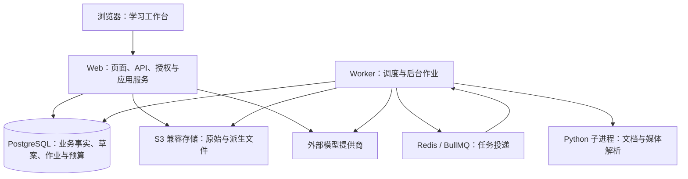

# 系统架构

本文描述当前仓库中的实现边界与学习闭环，更新于 2026-10-17。代码存在、检查通过、部署完成、用户验收、学习效果是不同状态；实时进度与阻塞统一查看 [项目状态](../STATUS.md)，切片与验收查看 [学习闭环剩余计划](../plans/2026-10-16-learning-loop-remaining-plan.md)。本文不作为线上发布清单。

## 1. 产品目标与架构取舍

AIstudy 是云端优先的终身学习平台，以目标学习、自由探索、笔记与知识库为三个平等入口。课程是可选的长期容器，资料、笔记、题目、卡片和学习记录通过统一资产与引用关联，不因进入另一个课程或计划就复制内容。产品依据为 [终身学习平台调整设计](../plans/2026-07-21-lifelong-learning-design.md)、[产品规格](../product/PRD.md) 与 [界面及 AI 规则](../product/UX_AND_AI_POLICY.md)。

当前交付重点是一个可回到下一次学习的闭环：开始学习 → 主讲或练习 → 保存作答与核对 → 形成有来源的证据 → 生成可解释草案 → 确认后执行 → 反馈与复测。计时、浏览、完成任务、自述理解均不能直接冒充掌握证据。

采用 npm workspaces 模块化单体：一个 Next.js Web 应用、一个独立启动的后台 Worker，共用契约、领域与持久化包。文档解析是 Worker 调用的受控 Python 子进程，尚无独立 Parser HTTP 服务。现阶段不按课程、规划、教学或评价拆微服务；优先把授权、事务、可恢复状态与包职责做好。

## 2. 当前运行拓扑

- Web 入口是 `apps/web/src/app`；当前学习页面在 `app/(opening)/opening`，API 在 `app/api/opening`。`features/opening/runtime.ts` 组装服务端依赖，认证运行时在 `apps/web/src/server/runtime.ts`。
- Worker 入口是 `apps/worker/src/index.ts`，启动时先检查配置与 Parser，再连接 PostgreSQL、Redis、S3；`runtime/queue.ts` 定义 parse、tutor、retest、remind、knowledge、media、study-actions、teaching 编译等队列。
- 普通后台作业由 PostgreSQL 作业及 outbox 记录投递到 BullMQ；Tutor 使用持久化 `opening_tutor_jobs`、确定性队列 ID 与执行认领。两者由 `apps/worker/src/runtime/dispatch.ts` 调度，不能笼统称为同一套 outbox。
- AI 主讲、材料解析等长任务走 Worker；临时对话等服务端请求也会直接调用模型，所以 Web 也有受预算与隐私策略约束的模型出口。
- PostgreSQL 保存业务事实及恢复依据，Redis 负责投递，S3 保存对象。队列状态或客户端缓存均不能代替已保存的学习记录。

实际技术选择已写入 `package.json` / `package-lock.json`：TypeScript、Next.js App Router、React、PostgreSQL + Drizzle/postgres、Zod、Redis + BullMQ、S3 SDK、Vitest 与 Playwright。版本以锁文件为准；[ADR-001](../decisions/ADR-001-stack.md) 保留选型背景。基础设施参考 [Compose](../../infra/docker/compose.yml)，Parser 安装与模型缓存见 [Parser 说明](../../services/parser/README.md)。

## 3. 模块职责与代码地图

| 模块 | 负责什么 | 主要入口与边界 |
|---|---|---|
| `apps/web` | 页面、浏览器状态、HTTP 边界、认证授权、应用用例组装 | `src/app`、`src/features/opening`；浏览器通过客户端 API 访问服务端，不直接访问数据库、队列或密钥 |
| `apps/worker` | 持久作业调度、材料/媒体解析、Tutor、主讲编译、补测候选、提醒 | `src/index.ts`、`src/runtime`、`src/jobs`、`src/parsers`；任务须重新校验归属、当前版本与隐私状态 |
| `packages/contracts` | Zod 输入输出、跨包 DTO、任务与备份协议 | `src/index.ts`、`src/opening`；定义边界数据，不执行 SQL 或作业务编排 |
| `packages/domain` | 纯业务规则、证据资格、学情汇总、排程与自适应策略、数学评价、测量模型 | `src/opening`、`src/portability`；只依赖 contracts，不连接数据库或模型 |
| `packages/database` | SQL 客户端、Schema、迁移、Repository、事务/锁、S3 适配与备份恢复 | `src/index.ts`、`src/schema`、`src/migrations`、`src/repositories`；持久化业务不变量在这里落实，迁移不在 `infra/migrations` |
| `packages/ai` | Provider 适配、模型路由、预算调用协议、上下文与引用、主讲编译及校验 | `src/opening`、`src/providers`；返回经校验的候选或内容，由宿主按用例保存，不获得任意写入权限 |
| `packages/config` | 环境配置注册与校验、模型目录、服务端开关、客户端无密钥能力协议 | `src/registry.ts`、`src/server-config.ts`、`src/public`；客户端能力决定显示，服务端每次请求决定是否允许 |
| `packages/jingwei` | 宿主无关的成果内容、修订、表达选择、能力注册与安全渲染协议 | 核心 `src/index.ts` 只依赖 Zod；React 适配为 `@aistudy/jingwei/react`。Opening 在 `features/opening/jingwei-host.ts` 接入教学/聊天能力，不把教学业务塞入核心 |
| `packages/ui` | 共享 Shell、导航、Drawer/Field/Status 等基础组件与设计令牌 | `src/index.ts`；不承担学习决策与数据持久化 |
| `services/parser` | PDF/PPTX 与媒体处理的 Python CLI、依赖锁与离线模型准备 | `opening_parser/__main__.py`、`requirements-lock.txt`；由 Worker 以超时、取消、输出限制等边界调用 |

辅助目录：`tests/integration` 是真实数据库/API 集成，`tests/integration/handler` 是路由用例，`tests/e2e` 是既有浏览器流程，`scripts` 是迁移与仓库工具，`infra` 是部署配置，`spikes` 是隔离实验。包内 `*.test.ts(x)` 与 `tests/fixtures` 提供就近规则和协议验证。

### 当前包依赖与分层约束

下表列的是当前 `package.json` 中的直接 workspace 依赖，不是预期中的理想分层：

| 消费方 | 直接 workspace 依赖 |
|---|---|
| web | ai、config、contracts、database、domain、jingwei、ui |
| worker | ai、config、contracts、database、domain |
| database | ai、contracts、domain |
| ai | contracts、domain |
| domain | contracts |
| contracts、config、jingwei、ui | 无其他 workspace 包依赖 |

应用层负责用例组装，领域规则保持纯函数；database 已使用 ai 的部分能力，不能把它误画成只依赖 domain 的纯底层。Web 的 `features/opening/runtime.ts` 还直接复用 Worker 的 `runtime/model-gateway.ts` 和 `source-page-images.ts`，这是现存跨 app 接缝；有实际复用改造需求时再收敛到共享服务端适配模块，不为文档整齐额外拆包。

`scripts/check-server-boundary.mjs` 从 Client Component 递归检查运行时依赖，阻止数据库、Redis、S3、Node 与 `server-only` 代码进入客户端。jingwei 核心的宿主隔离另由其边界测试保护。

## 4. 一次真实学习如何回到下一次行动

以下以“从今日任务学习一门课”为例。它描述已有生产代码路径；对应开关、课程与材料必须可用。

| 步骤 | 数据与控制流 | 主要源码 |
|---|---|---|
| 1. 读取今日与生成建议 | `GET /api/opening/today?date=…` 在已授权 scope 中读取任务、课表、课程要求与有效证据。自适应启用时组装快照，规则生成建议及原因；草案与已确认计划分开，GET 不自动接受教练安排 | web `planning/plan-service.ts`、`learner-snapshot-service.ts`；domain `adaptive/assemble-snapshot.ts`、`propose-tasks.ts` |
| 2. 选择并确认 | `POST /api/opening/plans/[id]/accept` 在同一事务检查归属、计划/任务/材料版本、硬约束与请求身份，只为选中的有效建议建任务，再保存已确认计划版本 | database `repositories/opening-plan-accept.ts` |
| 3. 开始学习 | 队列“开始此项”创建或复用教学活动，关联任务、课程、要求与材料；编译请求保存后台作业，Worker 按当前证据与隐私范围构建主讲单元，UI 展示发布后的内容 | web `planning/task-row-actions.tsx`、`teaching/activity-service.ts`；worker `runtime/compile-teaching-unit-wiring.ts`、`jobs/compile-teaching-unit.ts` |
| 4. 作答、核对与修订 | 服务端创建 Attempt 并保留题目/来源上下文；提交时结合实际已交付提示记录，写入 Observation。参考核对与确定性矩阵评价分开；异议或更正追加 revision，不覆盖原始记录 | web `learning/attempt-service.ts`、`observation-service.ts`；database `opening-learning-attempts.ts`、`opening-learning-observations.ts`、`opening-observation-revisions.ts`、`opening-matrix-evaluation.ts` |
| 5. 重新读取有效证据 | 当前 Observation head 经来源、要求、版本与独立性等资格规则进入课程学情和下一次快照。换材料或修订会改变资格；“未知”保留为未知，不把自述或模型建议升级为可信作答 | domain `evidence-eligibility.ts`、`learning-summary.ts`、`adaptive/snapshot-evidence.ts`；database `opening-learning-read.ts` |
| 6. 执行反馈与后续安排 | 完成/跳过/推迟写任务版本与反馈事件；建议“不适合”独立保存。补测、卡片复习、局部重排复用各自入口；重排先预览再确认，固定块在接受时重验，不能改掉无关安排 | database `opening-plan-feedback.ts`、`opening-suggestion-feedback.ts`、`opening-local-replan-validation.ts`；web `planning/plan-service.ts` |
| 7. 核对闭环与进入下一次 | `GET /api/opening/plans/metrics` 只读汇总运行可靠性、学习结果、负担与控制；阶段成果保存学生确认与证据引用。下一次今日草案重新读取事实，形成新的建议 | web `planning/loop-metrics-service.ts`、`loop-metrics-panel.tsx`；database `opening-loop-metrics.ts`；domain `adaptive/loop-metrics.ts` |

这里不存在“每次作答必须等待队列重算才能保存”的统一链路。学习事实在数据库写入，学情与草案按各自读模型/快照路径计算；AI、解析与主讲编译的异步状态另行跟踪。后台失败不得丢失已提交的答案，也不得把仍在排队或结果未知的任务显示为成功。

## 5. 闭环必须守住的边界

- **归属与授权：**HTTP 先取得用户与工作区 scope，Repository 在真实查询/写入处校验归属；客户端提交的 ID 不构成权限。AI 与异步作业再次校验当前隐私 epoch、来源授权和版本。
- **事实与推导：**Attempt、Observation、revision、任务动作是不同事实。当前 head、资格、学情、建议、模型概率是可解释的投影，不能改写历史事实。课程/要求/版本隔离，遗留未知身份不强行映射为新技能。
- **候选与正式变更：**聊天任务建议、计划草案和已确认安排分开。对话转计划复用同一个候选消费与计划接受事务；教练使用显式 POST、启用凭据、预算与条件撤销，历史 `coach` 偏好本身不授权自动接受。
- **并发与未知结果：**使用对应事务、行锁/咨询锁、版本及幂等回执保证具体不变量。不同接口重放语义不同：计划接受可按请求键重放，旧任务版本冲突仍可返回 409；网络结果未知先核对原请求，不换身份重建。
- **评价与测量：**确定性矩阵评价仅覆盖服务器定义的窄题型。`opening/measurement` 的首次作答、独立延迟测验与 BKT/频率事前预测是独立测量事实；`features/opening/measurement/runtime.ts` 明确不将其直接用于生产学习决策。预测答对概率不能作为已掌握的结论，代码通过不是学习收益证明。
- **预算与降级：**模型调用保留预留、执行认领、结算及 unknown。AI 不可用时保留可用的笔记、已保存内容、人工操作与规则路径，明确显示受阻原因；不能把失败伪装成新的可信内容。
- **可移植与恢复：**旧版 `aistudy-native` 备份只覆盖其内容资产范围；Opening 备份按 Repository allowlist 保存学习、规划反馈等记录及来源对象，二者都不包含三张 measurement 表。测量 JSON 是分析导出，没有导入恢复能力；测量进度须使用整库备份恢复，站点的来源对象另行备份。导入内容不能自带可信服务器评分，隐私过滤后的失效引用须清理。精确范围以 [备份格式说明](../operations/opening-backup-manifest.md) 和 [测量插件恢复说明](../quality/learning-measurement-plugin.md) 为准。

## 6. 已有实现、启用条件与后续方向

| 边界 | 当前含义 | 状态与依据 |
|---|---|---|
| 仓库已有 | Web/Worker、统一内容与课程、材料处理、Tutor/主讲、作答/修订/资格、规则草案与确认、反馈/局部重排、诊断、矩阵窄题、阶段成果、教练控制、测量插件 | 代码地图见上；S1–S7 见 [整合记录](../plans/2026-10-16-learning-loop-remaining-plan.md)。不是对所有入口已启用的承诺 |
| 受配置与数据前提约束 | 教学 API/UI、聊天表达、自适应规划、模型任务路由；课程材料、Parser 模型缓存、S3、Redis、Provider 与预算 | config `registry.ts` / `public/capabilities.ts`；服务端逐请求校验。关闭开关应保持相应既有路径 |
| 尚需发布与真实验收 | 现场 SHA、实际迁移、开关、Worker/Parser、恢复演练结果，用户页面交互，真实供应商表现与学习效果 | [STATUS](../STATUS.md)、[发布清单](../operations/adaptive-copilot-release-checklist.md)、[云端部署](../operations/cloud-deployment.md)、[测量插件验收](../quality/learning-measurement-plugin.md)。本次文档核对没有执行部署或浏览器验收 |
| 长期规划 | 资源市场、教师/班级协作、离线客户端与同步、插件 SDK、pgvector/高级检索、基于真实样本校准的高级自适应与规划 Agent | [长期实施计划](../plans/2026-07-21-lifelong-learning-implementation.md)、[资源平台方向](../business/OPEN_SOURCE_AND_MARKETPLACE.md)。现有实验或旧页面不等于发布能力 |

仓库迁移当前为 `packages/database/src/migrations/0001`–`0069`；0066 为测量、0067 为任务反馈、0068 为建议/教练控制、0069 为矩阵评价。这个范围只说明版本化文件存在，不能推断某个环境已经应用。部署需备份、按序迁移、更新 Web 与 Worker 并检查实际运行状态；回退应用时保留新增事实，尤其不能把旧读取器不认识的新评价值当作无数据变更回退，具体策略见 [剩余计划的发布与回滚](../plans/2026-10-16-learning-loop-remaining-plan.md)。

长期仍保留这些原则：共享内容与个人学习状态分离；历史作答引用其原内容版本；AI 不自动发布正式共享内容；容器化云部署先行，按真实需求演进自托管与轻量客户端。资源包 follow/pin/fork、完整离线同步与高级预测属于后续设计，不混入当前主闭环的完成定义。

## 7. 开发与验收入口

开发先读 [STATUS](../STATUS.md) 和负责目录的 `AGENTS.md`，按用例定位模块，只改拥有该行为的层；日常运行最近的规则/契约/接口测试与受影响包类型检查。文档改动只检查内容、链接与 diff，完整 CI、发布和恢复按现有机制执行，不新增平行任务账本或证据体系。

浏览器交互、视觉、响应式和真机由用户验收；Agent 提供入口、数据/环境前提、步骤、预期结果与已知问题。非浏览器检查、现有 CI 浏览器结果、用户验收与学习效果分开记录，参见 [根目录约定](../../AGENTS.md) 和 [CI 说明](../operations/ci.md)。
