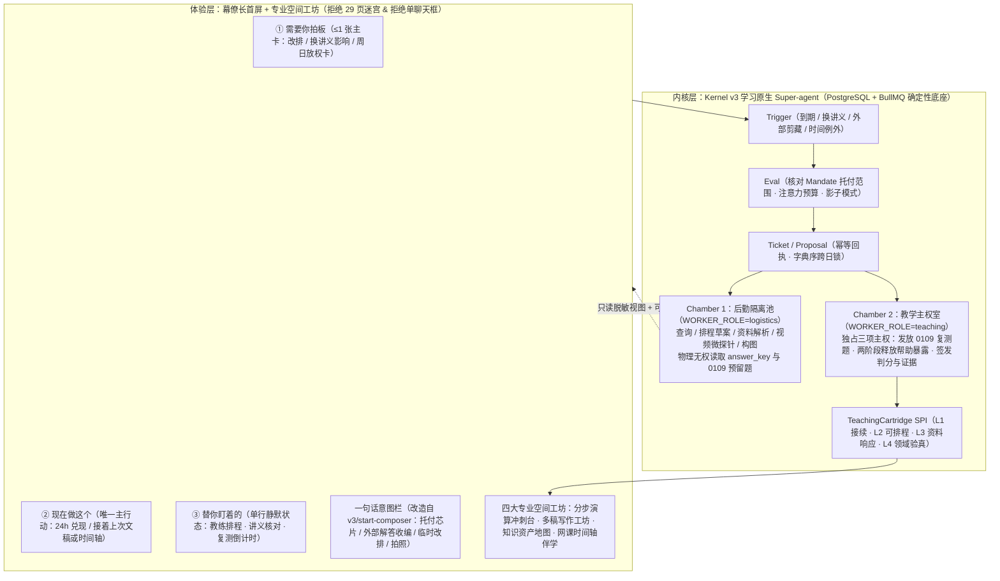

# AIstudy 架构定界、第三代学习原生 Super-agent 升级与国内外全流程商业化总蓝图（v2.1）

> 本文在首版收敛稿基础上，针对**「项目本质架构究竟对齐新版 Super-agent 还是旧版、有哪些超越通用 Agent 的原创升级构想、以及国内外真实市场需求与宣发收款财税全商业闭环」**三大核心命题，经五路异构视角（综合主持、认知与算法架构、产品哲学与破圈交互、全栈工程审计、国内外市场与全流程商业化）开展**多轮自驱深潜核查（Self-Directed Deep Dive）**后定稿，并在 **v2.1** 正式固化创始人的四项执行拍板（第二旗舰卡带锁定雅思、`@aistudy/senseweave` 冻结与 `@aistudy/jingwei` 升格、`v3/` 未引用孤儿文件冻结、以及当前 100% 聚焦 Phase 0 / UI 收口 / 地图收敛而将商业化归档为 Phase 1+ 增长蓝图）。所有源码事实均核对至仓库实表与分支基线（`feat/opening-release` `b1b98a9c`，已含 `#449`–`#456` 及 `#454` `eb966c84`；`integration/opening` 已含 `#448` `02d0bfb3`）。

---

## 1. 架构本质终极裁决：旧版 vs Super-agent（Kernel v2）vs 第三代学习原生架构（Kernel v3）

### 1.1 当前代码库的真实坐标：58% 处于从「旧版课程中心」向「Kernel v2」的半渡期

源码逐行审计表明，AIstudy 当前并非单纯的“旧架构”或“已完成的 Super-agent”，而是处在**约 58% 完成度的架构转型半渡期**：

1. **已落地的 Super-agent 骨架（`Kernel v2` 先行切片，`#443–#456`）**：
   - 延迟复测排程窗口已从单课程硬编码抽离为跨课统一窗口；
   - [opening-knowledge.ts](../../packages/database/src/repositories/opening-knowledge.ts) 与 `build-course-knowledge` 已实现课程资料变更合并与 `coveredSourceVersions` 静默核对；
   - 无课程多稿写作工作台与跨活动恢复（[opening-current-learning-activity.ts](../../packages/database/src/repositories/opening-current-learning-activity.ts)）已将标星等非接续操作剥离；
   - 已合入主线的 `#454`（`eb966c84`，UI 待用户浏览器验收）已通过双事务 `DayOverride` + 按本地日期字典序加锁（`opening-daily-draft:${workspaceId}:${day}` → 历史锁）跑通跨日时间改排。
2. **仍拽住系统的四大旧版遗留耦合**：
   - **单轮对话与单 Handler 巨石**：[tutor-turn.ts](../../apps/worker/src/jobs/tutor-turn.ts)（605 行）将租约心跳、父预算、课程下一步、草案提议、系统只读查询、语言支持与流式教学 7 重职责硬塞在同一入口；
   - **课程与学科硬编码**：20 个核心 API 强绑 `courseId`，48 个非测试文件耦合线性代数 `spanLesson / span-exact-v1 / SpanDraftAnswer`（含 12 个已弃用非 `/api/opening` 历史路由）；
   - **界面碎片化与幕僚长隐身**：`(opening)` 下膨胀出 29 个页面，`v3/` 目录 50 个非测试源码文件（含测试共 53 个文件）中仅 `v3/motion/*`、`v3/shell/*`、`v3/ui/*`、`v3/workspace/split-view.tsx` 4 组子域存在外部引用（直接外部引用入口共 10 个文件，含子目录内配套共 23 个非测试源码文件），另有 27 个非测试源码文件外部零引用（其中 `v3/start/start-composer.tsx` 与 `v3/learning/session-summary.tsx` 为白名单待复活组件，其余 25 个为孤儿样板）；而 `ActionDigest`、`LocalReplanCard`、`CoachPlanControl` 等核心 Agent 能力竟全部埋在 `/opening/settings/learning?planning=1`（导致教练自动确认在 `/opening/today` 首屏**实际从不触发**）；
   - **推理缓存倒置与备份脑裂**：[provider.ts](../../packages/ai/src/opening/provider.ts) 的 `buildInput` 将高频变化的 `input.text` 拼在稳定课程资料之前（且将资料置于动态 `history` 之后），直接破坏跨轮 Prefix Cache；[opening-backup-records.ts](../../packages/database/src/repositories/opening-backup-records.ts) 在 110 张实表中仅覆盖 45 张，且须严防误将 `0109` 预留复测题表或课程知识内部定义导出至学习者客户端。

### 1.2 两层明确裁决：内核层全面升级 Super-agent，体验层坚决拒绝“单聊天框包打天下”

对照 DeepSeek Harness 2026 年 10 月 31 日发布的《Super-agent 设计探索：迈向更自主的 Agent 系统》（`dsh-superagent-prototype`）与仓库 [长效学习 Agent 候选架构](2026-11-18-long-running-learning-agent.md)，AIstudy 的最终架构定位分两层定死：

| 架构层次 | 明确采用（参考新版 Super-agent） | 明确拒绝（剔除旧版惯性与通用 Agent 陷阱） | AIstudy 终极形态（Kernel v3） |
|---|---|---|---|
| **运行时内核层** （看不见的调度与状态机） | 采纳 `dsh-superagent` 的 **`Trigger → Eval（托付规则）→ Ticket（有归属事项）→ Isolated Executor`** 四段式流水线、**注意力预算（Attention Budgeting）**与**影子观察模式（Observe / Shadow Mode）**；延续 `Kernel v2` 以 PostgreSQL 事务 + BullMQ 为唯一事实源 | **淘汰旧版 4 项假设**（一次对话=一个工作单元、所有学习必属某门课、AI 只能被动问答、规划只管今日清单）；**同时拒绝通用 Coding Super-agent 让大模型在后台自由写文件/自由改分数的无护栏自治** | **受确定性领域不变量约束的长期学习委托内核**：LLM 负责意图理解、错因假设与反馈表达；证据资格、复测窗口、预算结算与跨日锁序 100% 由确定性状态机裁决 |
| **用户交互体验层** （看得见的首屏与工坊） | 采纳“少打扰人、把跨天跨资料的脏活留在后台、只在需要拍板时浮出可逆卡片”的幕僚体验 | **既淘汰旧版 29 页 ERP 仪表盘，也坚决拒绝把数学演算、论文多稿对比、网课时间轴塞进同一个聊天框** | **「幕僚长三问首屏 + 一句话意图栏 + 专业空间工坊」**：首屏像幕僚长汇报，点进去是各学科趁手的专业工坊，结果回流发起工坊 |

---

## 2. 超越通用 Coding Agent 的四大第三代学习原生架构创新

通用 Super-agent（如编码助手或办公助理）的目标是**「替人类把活干完、越快交付答案越好」**；而学习 Agent 一旦替学生把题做完，学习效果当场归零。围绕这一根本矛盾，AIstudy 提出 **4 项具备技术壁垒的第三代学习原生架构升级**：

### 2.1 创新一：双室认知主权物理隔离（Epistemic Bicameral Harness）
- **解决的核心痛点**：普通 AI 助教把“排计划、查资料、闲聊”与“判分、管答案、发复测题”混在同一上下文与同一数据库连接中，极易通过提示词诱导泄题或误记帮助暴露。
- **代码与数据库三重物理隔离（不止靠 Prompt）**：
  1. **Worker 角色拆分**：扩展 [worker-role.ts](../../apps/worker/src/runtime/worker-role.ts) 与 [tutor-turn.ts](../../apps/worker/src/jobs/tutor-turn.ts)，拆出薄分发壳（~80 行，保留 30s 租约心跳与 `parentBudget`），后端分离为 **`WORKER_ROLE=logistics`（后勤室）** 与 **`WORKER_ROLE=teaching`（教学主权室）**，同时完整保留 [tutor-stream.ts](../../apps/worker/src/runtime/tutor-stream.ts) 的 Redis SSE 流式协议（前端零感知）。
  2. **编译期端口封禁**：`LogisticsDeps` 物理移除预留题、隐藏答案块与判分写接口，仓库边界门禁脚本禁止 `logistics/**` 引用相关仓储。
  3. **PostgreSQL 角色与脱敏视图隔离**：后勤室连接池使用受限角色 `aistudy_logistics_ro`，对 [0109_opening_course_reserved_questions.sql](../../packages/database/src/migrations/0109_opening_course_reserved_questions.sql) **零 `SELECT` 权限**，读取教学单元强制走剔除 `answer_key / hidden` 块的视图 `v_public_teaching_units`；唯独教学主权室独占 **`issueReservedQuestion`（发放预留题）、`releaseHelpExposure`（两阶段确认送达放行）、`recordVerdictAndEvidence`（写入判分与达标证据）** 三项主权端口。

### 2.2 创新二：可区分竞争错因的神经符号探针（Discriminating Next-Item Neuro-Symbolic Probe）
- **解决的核心痛点**：学生做错一道题往往对应 2–3 种不同错误规则（例如极限题得 `0`，可能是“加减法直接等价无穷小替换”，也可能是“泰勒展开阶数截早了一阶”）。传统题库盲目推 5 道同章题，既耗时又挫败。
- **神经符号协同机制**：LLM 根据首错提出竞争错因假设 $H_A, H_B$ 及最小两步探针参数；**符号引擎（SymPy / 规则检查器）在发题前预先验算**——只有当候选探针题在按 $H_A$ 演算与按 $H_B$ 演算会得出**严格可区分的不同中间值/选项**时才获准发放。1 道 45 秒微探针即可锁定真错因，终结盲目刷题。

### 2.3 创新三：可证伪的离线巩固引擎（Falsifiable Sleep-Time Consolidation）
- **借鉴与超越**：吸收 Anthropic `Dreams` 离线记忆整理与 Letta `MemFS` 上下文工程思想，但严守学习证据红线——后台离线整理任务**只产出「带依据快照的可证伪跨课薄弱假设 + 下次可区分变式的参数种子」**（如识别出高数积分换元失误实为三角恒等变形薄弱），**绝对禁止离线静默篡改正式 `LearnerState`、禁止写入 `opening_help_exposures`、禁止刷新 `opening_teaching_activities.updated_at` 抢占“接着上次”**。所有离线假设必须经学生下一次真实独立作答证伪或证实。

### 2.4 创新四：`L1–L4` 可插拔教学卡带协议（`TeachingCartridge` SPI）+ 精卫升格与 `v3/` 孤儿冻结
- **解耦 48 个 `span` 耦合文件而不推倒重来**：无需重写全部 48 个线代文件，只需打开**正式评价契约（`matrix-evaluation.ts`）、证据资格判定（`evidence-eligibility.ts`）与学情投影（`learner-state.ts`）**三处宿主边界，将学科模块标准化为 `L1_CONTINUITY`（可接续）、`L2_SCHEDULABLE`（可排程）、`L3_MATERIAL_REACTIVE`（讲义变更响应）、`L4_EVIDENCE`（具备可信机器/量规验真回执）四级渐进卡带：
  - **第一旗舰卡带 · 高数/线代卡带（`L1–L4`）**：有限域参数模板 + SymPy 恒等式复核 + 异家族盲解；
  - **第二旗舰卡带（已拍板锁定）· 雅思卡带（`ielts-writing-speaking-v1`，`L1–L4`）**：作为紧随高数/线代之后的**第二旗舰学科卡带**（与 408 数据结构/计组卡带并列推进，雅思优先落地多稿写作与量规评阅工坊），完整提供**双栏多稿对照精批、TR/CC/LR/GRA 四维量规证据回执、跨稿句式/论点迁移与口语复述反馈**，严格区分练习改稿与经量规复核的独立作答证据；
  - **并行推进卡带 · 408 数据结构/计组卡带（`L1–L4`）**：栈/队列/指针/Cache 确定性状态轨迹验真（已在严格 TypeScript 编译与 13 组内存领域样例中跑通 `408.stack.v1`，与旧 `span` 零冲突共存）；
  - **通用多稿写作与费曼口语基座（`L1–L3` + 可选量规 `L4`）**：支撑通用无课程多稿修订迁移（诚实标记不冒充闭卷应试掌握）及费曼讲解练习反馈。
- **渲染器与 `v3/` 孤儿清理拍板（已获用户授权按工程最优裁决执行）**：
  - **渲染内核裁决（11 倍体量悬殊）**：保留并升格轻量安全的 **`@aistudy/jingwei`（16 文件、874 LOC，5 处核心教学链路在用）** 作为卡带统一结构化交互渲染器；**立即默认关闸并冻结 `@aistudy/senseweave`（75 文件、9,563 LOC，仅 3 处可选文本装饰引用）**，90 天内剥离归档；
  - **`v3/` 孤儿文件冻结与底座保护**（当前 `v3/` 共 49 个非测试 `.ts/.tsx` 源码文件、3 个活跃回归测试文件与 1 个 `README.md`）：**已外部接线保留**：`v3/motion/*`（全站动画与视图过渡核心底座，含被非测试源码外部引用 94 次的 `view-transition` 与 3 次的 `feedback`）、`v3/shell/*`、`v3/ui/*`、`v3/workspace/split-view.tsx`（直接外部引用入口共 10 个文件，含这 4 组子目录配套共 23 个非测试 `.ts/.tsx` 源码文件，并随被测组件一并保留 `v3/shell/features.test.ts`、`v3/shell/use-layout-pref.test.tsx` 与 `v3/workspace/split-view.test.ts` 共 3 个回归测试文件）；**冻结但白名单保留待复活**：`v3/start/start-composer.tsx`、`v3/learning/session-summary.tsx`（当前外部引用为 0，共 2 个 `.tsx` 文件）；**其余 24 个未引用非测试 `.ts/.tsx` 孤儿源码文件予以冻结**（禁止新增引用或继续堆叠样板），并统一纳入 VibeDesign 触感体系协同收口。

---

## 3. 体验层重塑与五大低获客成本破圈产品飞轮

### 3.1 「幕僚长三问首屏」与零新表「一句话托付 + 7 天影子周」

1. **首屏外科手术（修复“幕僚长被藏在设置页”的断层）**：
   - 将埋在 `today-view.tsx`（仅 `planning=true` 可见）与 `/opening/suggestions` 的核心组件提炼进 [today-dashboard.tsx](../../apps/web/src/features/opening/planning/today-dashboard.tsx) 的**三区首屏**：
     - **① 需要你决定（最多 1 张主卡）**：合并 `LocalReplanCard`、`ActionDigest` 首条待确认项（复用 `0052` 表的 `dedupe_key = "${target}:${impactRevision}"` 零新表去重）、最新待定提案与周日放权卡；
     - **② 现在做这个（唯一主行动）**：保留 `ContinueCard` 与跨活动显式接续（修复通用编辑器改稿漏推进、而后台教学发布却误刷 `updated_at` 抢占“接着上次”的反转 bug）；
     - **③ 替你盯着的（单行静默栏）**：将 `CoachPlanControl` 移至首屏（通过显式幂等 `POST` 触发自动确认，严守 `GET` 读取绝不隐式写计划的不变量），展示教练排程、讲义核对与今日完成度；将 16.6 KB 的 `LongTermLearningCard` 与 `TodayCourseList` 移归“课程”页；
     - **一句话意图栏**：复活孤儿高价值组件 `v3/start/start-composer.tsx` 替换简陋的 `TodayAskBar`，前端先拦截“时间例外 / 外部 AI 收编 / 看完网课”专项路由，其余开放问题再走现有 5 值 `composer_purpose` 对话流。
2. **零新表、零迁移落地「一句话托付 + 7 天影子周（Shadow Week）」**：
   - 学生无需填写复杂设置表，只需说一句*“期末前帮我盯紧高数，每天最多 45 分钟”*，界面拆成可点掉的范围芯片（绝不提供“直接给答案/替我写”开关）；
   - **存储载体（零新表）**：托付本体照抄 `spanTutorGrantSchema` 写入 `workspace_preferences.adaptive_planning.mandates`（注意上线顺序：**先发宽松读取、再发写入**，避开 `.strict()` 回滚把整份偏好重置的陷阱）；影子周期间不写 `opening_assistant_proposals`（该表强绑 `source_turn_id NOT NULL`）也不刷偏好（会冲掉待定提案 `basis_version`），而是在每日自动草案生成时顺手写入宽松 JSONB **`opening_plan_drafts.input_snapshot.mandateShadow`**（重放纯函数 `decideCoachAutoAccept`）；
   - **周日放权仪式卡**：读取时动态对比 `mandateShadow` 与 `opening_plan_acceptances`，生成*“这周如果你放手，我本来会替你排好这 4 件事（其中 3 件和你自己后来选的一模一样）—— 下周起直接替你做？”*，点击即升级为 `active` 教练模式。

### 3.2 补齐「全仓零分享代码」断点与五大自传播产品构想

源码检索证实当前 `apps/web/src` 中 `navigator.share`、OG 预览图与公开挑战页全部为 **0**。围绕大学生真实痛点设计 **5 大低 CAC 自传播引擎**（前 4 项均可零新表在首季落地）：

| 破圈引擎 | 切中的真实高频场景 | 零新表 / 最小侵入工程落地方案 | 证据防污染护栏 |
|---|---|---|---|
| **① 外部 AI 收编站** （化豆包/ChatGPT 为免费获客漏斗） | 学生已在豆包/ChatGPT 看懂解析，但心里发虚怕考场写不出 | 照抄 `.eml` 导入新增 `POST /api/opening/imports/text`（意图栏粘贴 + PWA `share_target` + `#fragment` 书签脚本绕过跨站同源拦截，不碰企业单租户钉钉/IMAP）；落为 `text/markdown` 来源 → 一句话复述关键步 → `opening_tasks(origin='agent', not_before=明天)` 排入次日同招变式 | 无归属课程仅作自测不盖验真章；零迁移期若该要求正处活跃复测窗口则顺延至窗口关闭后再推变式（二期可加 `ALTER CHECK` 补 `external_capture`） |
| **② B站/YouTube 网课课代表卡** （吃透宋浩/王道/MIT 公开课流量） | 倍速刷完 2 小时网课以为全懂，做题全废；B 站评论区“课代表总结”天然高赞 | **零新增表、[media.py](../../services/parser/opening_parser/media.py) 一行不改（严守 SSRF 防线，绝不存盗版视频字节）**！`opening_sources.mime` 扩 `application/vnd.aistudy.external-video+json`，字幕入 `opening_source_chunks(start_ms, end_ms)`，封装官方嵌入播放器对接 [media-reader.tsx](../../apps/web/src/features/opening/sources/media-reader.tsx) 的 `onSeek(startMs)`，在概念转折点浮出 3–5 个 30 秒停顿微探针，一键导出带时间戳的「课代表验真卡」回流评论区 | 用户主动截板书帧限 `≤12 帧/h`，界面诚实标注“仅基于已截取帧，非全片视觉理解”；微探针默认作自测，经学生确认才预约正式复测 |
| **③ 笨学弟费曼擂台** （零主观争议的反向教学裂变） | “以为自己懂了”到“3 句话把死钻牛角尖的 AI 学弟讲通”的极强爽感与炫耀欲 | 协议 `teachback-arena-v1` 引用已编译题的隐藏 `misconceptions`：**第 1 步点出哪步错（确定性）+ 第 2 步选正确改法（确定性）**决定胜负（零模型判分争议、零额外判分成本），**第 3 步 ≤240 字讲清原因**由模型扮演学弟追问并回放变式正解；结果只存 `checkpointJson.arena` | 服务端门禁：目标要求有未关闭复测窗口时直接返回 `409` 拒开擂台，不写 `attempts / observations / help_exposures`，零污染复测队列 |
| **④ 翻车图鉴 + 统一无状态分享出口** （把“防踩坑”变成宿舍社交货币） | 考前最爱转“本课 64% 的人在第 2 步相减替换翻车，你 60 秒试试” | 照抄 `opening-asset-graph-cursor.ts` 的 HMAC-SHA256（强制校验 `AUTH_SECRET`），新增 `POST /api/opening/share`（服务端从权威记录组装签名 payload，不含 `userId`/分数/原题）+ 公开页 `/s/[token]` + Next 内置 `next/og` + 客户端 SVG 海报（微信内自动降级长按保存二维码海报）；同步解绑 [access-policy.ts](../../apps/web/src/features/opening/access-policy.ts) 的公开 `/try` 与受控注册开关 | 匿名群体错步率 `cohortRate` 仅在同课样本 `≥30` 时计算，否则置 `null`，严禁个人排名与羞辱式分数 |
| **⑤ 轻量陪跑搭子** （Phase 2 考季留存助推） | 考研/期末独自复习易断签，但讨厌卷分数的打卡群 | 双人配对仅互相可见“今晚完成了几场兑现 / 连续赴约天数”，物理不可见对方错题、分数与具体薄弱项 | 纯完成度投影，不触碰任何教学主权与隐私正文 |

---

## 4. 全栈P0工程护栏清算（三天可修、放任必出事故的隐患表）

1. **修复推理请求拼装倒置，预期大幅压降跨轮 Token 成本（基于真实 Prompt 长度测算，待真实负载核验）**：
   - 将 [provider.ts](../../packages/ai/src/opening/provider.ts) 的消息序列化顺序从“动态历史在先、最新提问拼在稳定课程资料前”重构为 **`[System] → [稳定已授权课程资料/量规前缀（清晰标注非信任材料边界）] → [动态对话历史] → [当前轮动态输入]`**，并在 [usage.ts](../../packages/ai/src/opening/usage.ts) 解析 `cached_tokens / cache_read_input_tokens`。
   - 基于真实 Prompt 长度的测算预期（待真实负载核验）：修复并启用国内外分层路由后，20 题族（60 题 + 60 次异家族盲解）单套 AI 编译费预计降至 **国内 ¥0.45–¥0.85 / 海外 \$0.40–\$0.85**；单生 28 天高频使用（60 轮辅导 + 18 次拍图 + 30 次判分 + 20 次提炼，40% 客观题走本地确定性判分）边际 AI 成本预计降至 **国内 ¥0.85–¥1.25 / 海外 \$0.35–\$0.65**。
2. **修复 3 处静默失真的状态机与并发间隙**：
   - **跨入口帮助归因（[opening-course-route-retest-state.ts](../../packages/database/src/repositories/opening-course-route-retest-state.ts) `readOpeningCourseRouteRetestOutcome` 第 62–69 行）**：补齐 `kind / support_domain` 过滤（避免纯语言辅助误伤数学独立资格），同时补上按题目版本/要求锚定的跨会话匹配（堵住 `session_id IS NULL` 的讲义摘录泄题漏网）；
   - **知识构图替换发布与回执同事务（[opening-knowledge.ts](../../packages/database/src/repositories/opening-knowledge.ts) `replace` 第 783–808 行）**：将实际处理的 `coveredSourceVersions` 随知识快照替换在同一事务持久化，消除进程在图提交后、`run-job` 写回执前退出导致的覆盖度失真，并严格区分“可读文本零节点”与“空文本不可读”；
   - **跨日改排跨午夜护栏与预算取消竞态**：在 `#454`（`opening-day-adjustment.ts`）持锁后补充“源日期仍为工作区今日且禁止移除确认时刻已结束的源块”校验；在 [opening-budget.ts](../../packages/database/src/repositories/opening-budget.ts) `changeState`（第 388–396 行）规定用户撤权只撤交付权限、唯独掌握传输层确证的调用所有者可判 `not_sent`。
3. **110 张实表 vs 45 张备份表全差集治理与 `0109` 整表禁导防泄题红线**：
   - 立即将漏备的安全学习者资产表（`library_*` 写作资产、`opening_course_knowledge`、`opening_exam_*` 冲刺表等）合并为统一的 `WorkspaceBundleV2` 快照，消除 Native 备份与 Opening 备份脑裂；导出 `opening_course_knowledge` 时剥离服务端私有 `node_definitions` 字段；
   - **高危反作弊拦截（整表禁导而非局部脱敏）**：当前 [opening-backup-records.ts](../../packages/database/src/repositories/opening-backup-records.ts) 第 7–20 行的 `OPENING_BACKUP_TABLES` 固定白名单原本未导出 [0109_opening_course_reserved_questions.sql](../../packages/database/src/migrations/0109_opening_course_reserved_questions.sql) 中的三张私有表，且若仅剥离 `available/reserved` 行仍会泄漏 `issued` 行与未发放即 `revoked` 行的 `key_json`（见 `0109` 第 17–47 行）。因此**学习者备份必须继续将 `opening_course_reserved_questions`、`opening_course_question_exposures` 与 `opening_course_question_exposure_coverage` 整表排除在 `OPENING_BACKUP_TABLES` 导出白名单之外，并在恢复侧与契约测试中新增拟议的 fail-closed 禁导/禁恢黑名单断言（`BACKUP_FORBIDDEN_TABLES` / `OPENING_RESTORE_NEVER_TABLES`）**，绝不向客户端导出或回放任何预留题与答案键；
   - 将上述 `0109` 题库曝光表、**安全/凭证/队列/预算账本表 + 全部新增商业订单与权益表** 统一纳入该拟议 fail-closed 黑名单强断言，封死“导出备份偷题”与“回放旧快照无限刷额度”。

---

## 5. 国内外真实市场容量与全流程商业化闭环（从首单验证到规模化营收）

### 5.1 市场容量与竞争窗口研判基准（2026–2027 调研快照，提升至正式 PRD 前须逐项复核一手信源）

- **国内市场（庞大的刚性应试与在学基数 + 拍题搜题信任危机）**：
  - 高等教育在学总规模 **4,872.57 万人**；**2027 届全国硕士研究生招生考试报名 347 万人**（2025 届 388 万、2026 届 343 万，高数/线代/概率与 408 计算机统考为最高客单刚需区）；国家统一法律职业资格考试客观题报名 **93 万+**、注册会计师（CPA）报名 **76.29 万**、2026 国考通过资格审查 **371.8 万**；雅思单次考试报名费高达 **¥1,990**（重考一次的金钱与时间痛感极强）。
  - 豆包、夸克把“免费一秒出答案”推到极致的同时，制造了空前普遍的**“平时作业全对、期中期末闭卷崩盘”**痛点——AIstudy 不跟大厂卷通用搜题，而是卡位**「考前验真与高分冲刺闭环」**。
- **海外市场（Chegg 崩塌腾出的数十亿美元真空 + 昂贵重修费锚点）**：
  - 传统搜题巨头 Chegg 收入持续剧烈萎缩（2025 年报净收入同比再跌 **39%** 至 \$3.769 亿），而新一代 AI 学习应用依靠短视频裂变高速起量：**Gizmo** 达 1,300 万用户并获 \$2,200 万 A 轮，**StudyFetch** 与 **Turbo AI** 双双突破千万美元级 ARR（Turbo AI 通过 `turbocreators.com` 招募零粉学生创作者按 **\$20+/条视频 + 激励奖金** 铺量）；
  - 美国公立大学单门 3 学分课程挂科重修直接学费高达 **\$1,446（州内）– \$2,625（州外）**，使得 **\$29–\$39 期末通关包 / \$99 年卡** 具备极高决策性价比；同时 RevenueCat 2026 报告显示教育类应用年订阅中位续订率仅约 **24%**，印证了**“先用固定期限 Exam Pass 低阻力成交，再向跨学期年包升档”**的科学性。

### 5.2 核心财务纠偏：公域冷流量直卖 ¥49 必亏，必须搭建「三级火箭产品价值阶梯」

队列精算证实：即便将单生 AI 成本压至 **¥1.25**，在小红书或 B 站买冷流量直接售卖单一 **¥49** 期末包，扣除平台组件费、退款预留与获客成本后，**单品贡献 ROI 仍为 −17.3% 至 −21.6%**！¥49 适合校内平行班裂变与私域首单破冰，而公域规模化盈利必须依靠**「钩子引流 → 入门建信 → 高毛利核心包/订阅升档 + 小型督学室 B2B 席位」**三级矩阵：

| 市场 | 第一级：低阻钩子款（获客建信） | 第二级：考季入门款（破冰转化） | 第三级：主利润核心款与 B2B 经常性收入（贡献主力） |
|---|---|---|---|
| **国内矩阵** | • 免费 `/try` 90 秒猜错步挑战 / 课代表卡 / 收编站 • 小红书站内虚拟发货 **¥9.9 原创错因诊断包**（获客前贡献 **¥7.30**，可抵扣大包） | **¥49 / 28 天 高数/线代期末冲刺包**（到期自动停，获客前净贡献 **¥36.75**；主攻校园同班传播与私域首单） | • **¥129** 考研数学/408/雅思单阶段包（净贡献 **¥105.25**） • **¥199** 多阶段核心包 + 分批集中轻督学（净贡献 **¥159.25**，公域回本核心锚点） • **¥269** 扩展包 + 限量人工抽阅（净贡献 **¥212.00**） • **B2B 小型考研/留学督学工作室 SaaS**：**¥799（30席）/ ¥1,299（60席，月净贡献 ¥729）/ ¥1,999（120席）/ 月** |
| **海外矩阵** | • 免费 Calculus I / AP Calc / CS 错步挑战页 • YouTube 公开课伴学微探针卡 | **\$19 / 月** 月度订阅（净贡献 **\$14.00**）或 **\$39 学期 Exam Pass**（净贡献 **\$28.70**，无续费负担） | • **\$89 – \$119 / 年** 跨学期 STEM 通行证（按 **\$99** 计扣除全周期预留后净贡献 **\$68.00**） • 大学 Tutoring Center / 辅导机构席位包 |

**每 1,000 名合格到达队列财务模型（已扣退款、支付通道费与履约预留）**：
- **国内公域队列（投入 ¥4,000 / 观察 180 天）**：450 人完成首诊 → 80 单 ¥9.9 + 50 单 ¥49 → 其中 18 人升档 ¥199、12 人直购 ¥199、6 人二购（抵扣 30 张 ¥9.9 券） ⇒ 净收款 **¥10,109**，获客前贡献 **¥7,857.50**，去重主产品买家 62 人（**CAC = ¥64.52**），**队列 LTV/CAC = `1.96×`**，扣除渠道投放后净赚 **+¥3,857.50**（盈亏平衡点：每千次合格到达至少成交 **12 笔 ¥199 核心包**）。而 B2B `¥1,299/月` 督学室档位按 `¥1,800` 销售上手成本计，**仅需 2.47 个月回本，12 个月 LTV/CAC 高达 `3.72×`**！
- **海外公域队列（投入 \$1,100 / 观察 12 个月）**：40 单 \$19 月卡 + 20 单 \$39 Pass → 14 人升档 \$99 年包 + 6 人直购年包 + 12 个续费月 ⇒ 净收款 **\$3,748**，获客前贡献 **\$2,662**，去重买家 66 人（**CAC = \$16.67**），**队列 LTV/CAC = `2.42×`**，扣渠道后净赚 **+\$1,562**。
- **通往规模化里程碑（国内 ¥10 万 MRR + 海外 \$1.5 万 MRR）的精确配比**：
  - **国内 ¥100,050 MRR**：**50 家小型督学工作室（`× ¥1,299/月`）+ 900 名活跃月订学生（`× ¥39/月`）**（考季 ¥129–¥269 固定包现金流在此之上额外叠加）；
  - **海外 \$15,001 MRR**：**600 名年付会员（`× $99/12`）+ 529 名月付会员（`× $19/月`）**（外加 \$39 Exam Pass 考季脉冲现金流）。

### 5.3 国内外全渠道宣发 SOP 与首月预算分配（¥6,000 + \$1,200 小步快跑）

- **国内四路宣发飞轮（首月预算上限 ¥6,000，按周 `¥1,200 → ¥1,800 → ¥2,100 → ¥900` 滚动放量）**：
  1. **小红书搜索拦截矩阵（¥1,800 / 12 篇精制笔记）**：围绕「教材章节词 / 高频翻车错步 / 考前 7 天自救 / 考研数学一轮」四组长尾词，首图直接抛出一行典型错误推导（如*“高数期末｜两项各自能替换，相减后还能吗？”*），滑到第 2 张互动选错步，承接站内合规虚拟发货 **¥9.9 诊断包** 或私域口令；
  2. **B 站网课时间轴联动 + 评论区课代表卡（¥1,500）**：签约 2 位垂直高数/408 UP 主做伴学时间轴联动（`04:10 选出失效替换 → 09:40 同族变式 → 结尾领明日复测`），同时鼓励真实学生将生成的「课代表时间戳验真卡」发在公开课评论区自然获赞引流；
  3. **微信 7 天轻督学转化营 + 10 家督学室直拓（¥1,000 营运 + ¥800 编审）**：`D0` 免费错步诊断 → `D1` 24h 独立变式兑现（多巴胺峰值推 ¥49 / ¥199）→ `D3` 错因图鉴分流 → `D7` 集中直播/群答疑（严禁陷入一对一免费无限私聊）；同步向 10 家线下自习室/考研督学工作室演示机构席位看板；
  4. **机动补投池（¥900）**：仅追投已跑出真实净订单与健康退款率（`≤8%`）的素材。
- **海外三路低成本获客引擎（首月预算上限 \$1,200）**：
  1. **TikTok / Reels / Shorts 零粉大学生 UGC 矩阵（\$600 底费 + \$180 剪审 + \$120 有效到达奖金）**：招募 5 名海外理工科大学生建立原生新号产出 30 条竖屏短片（前 3 秒痛点钩子：*“Calc I final tomorrow? 70% break this limit on line 2”* → 手机点选错步特写 → 24h 独立通关展示，合规披露商业合作）；
  2. **精选 30 → 300 页高意图错题陷阱 Programmatic SEO**：针对 `u-substitution bounds mistake`、`integration by parts sign error`、`AP Calc FRQ common traps` 等具体失分点生成带交互微探针的高质量静态公开页（拒绝低质 AI 洗稿农场）；
  3. **校园社团与 Reddit/Discord 助教口碑渗透（\$150 校园种子 + \$150 预留）**：在考前两周向 STEM 助教与学习小组提供免费班级错步热力图试用。
- **铁血止损与扩量门禁**：单主题满 100 个合格到达后，首诊完成率 `<35%` 立即改题目/落地页；首诊 `≥40%` 但次日复测回流 `<25%` 立即改提醒与时间窗；连续两批队列 `LTV/CAC ≥ 2.0×` 且国内 60 天内回收渠道费，才允许预算翻倍。

---

## 6. 支付网关、三账本解耦、海内外合规财税与 Open-Core 创作者生态

### 6.1 2026-11 最新双轨支付底座与「三事实账本」无缝接线

> [!IMPORTANT]
> **重大支付变动核实**：知名海外 MoR 平台 **Lemon Squeezy 已于 2026 年 11 月 16 日正式停止新商家注册**（并入 Stripe Managed Payments，不仅不支持中国大陆主体直开，且条款明确排除第三方市场分账与真人一对一辅导）。架构与商业计划中已彻底移除 Lemon Squeezy。

1. **国内外双轨收单路线**：
   - **海外 Track 1（Day 1 零税务负担全球收单）**：采用成熟 SaaS MoR **Paddle**（`5% + $0.50`，全自动代征代缴欧盟 VAT 与美国各州销售税）或开发者友好的 **Creem / Polar.sh**；
   - **海外 Track 2（月流水破 \$5k–\$10k 后降费率并行）**：设立 **美国 LLC + Stripe 直连**（费率降至 `~2.9% + $0.30`，注意外资独资 US LLC 每年须按规提交 **IRS Form 5472 + Pro-forma 1120** 信息申报，严防 \$25,000 漏报罚金）；
   - **国内 Stage 1（冷启动零阻塞）**：企业/合规店铺售卖一次性核销兑换码（`entitlement_redeem_codes`）；
   - **国内 Stage 2（规模化闭环）**：接入 **2026 微信小程序「AI 应用成长计划」虚拟支付**（打通大学生微信内拼团与移动端闭环）+ **企业微信支付 Native/JSAPI + 支付宝当面付/电脑网站支付**。
2. **与 [opening-budget.ts](../../packages/database/src/repositories/opening-budget.ts) 的三账本解耦（修复无币种混加与向上取整失真）**：
   - 源码核查发现现有 `amountCents` 无币种列（混配中美模型会把人民币分与美元美分直接相加），且 [usage.ts](../../packages/ai/src/opening/usage.ts) 的 `estimateUsage` / `reservationCentsForInput` / `actualCentsForOutput`（第 36、60、65 行）均按单次调用 `Math.ceil` 向上取整。商业化层明确拆分为同一事务边界协调的**三类独立权威事实**：
     1. **商户订单账（收了多少钱）**：`merchant + providerOrderId + orderLine`（Webhook 幂等去重、含税额、退款与拒付冲回）；
     2. **用户交付权益账（还能用几次）**：`grantId + benefitCode + periodId`，按学生可理解的完整交付计次（如 1 次「拍照步骤评阅」内部无论调几次 OCR/LLM/CAS 只在**可用结果持久化并获准交付时扣 1 次**，超时无结果绝不吞次数；`BYOK` 在模型路由选路层硬拦截，严禁静默回退消耗平台密钥）；
     3. **底层供应商准入与原币成本账（花了多少钱）**：保留 `opening-budget` 单部署单币种保守准入熔断，另记供应商原币高精度微元成本与缓存命中明细。

### 6.2 国内备案合规、2026-11-01 自然人增值税扣缴新规与创作者市场

1. **国内合规上线时间轴与模型路由硬隔离**：
   - 主体采用**有限责任公司**（隔离个人无限连带责任），推进 **ICP 备案 → 属地省级网信办生成式 AI 大模型应用服务登记（调用已备案国产大模型 API 走应用登记拿“S”号，周期约 3–4 个月，远快于自训底座备案）+ 互联网信息服务算法备案**，并严格遵守 2026 年 7 月起施行的拟人化互动服务管理要求（不在未成年人与情感依赖上越界，保持清醒克制的学习幕僚定位）；
   - 国内部署强制锁定已备案境内推理节点（DeepSeek / 通义千问 / 豆包企业 API），海外部署独立运行全球模型栈（Gemini / OpenAI / Anthropic），物理杜绝境内学生数据跨境裸奔。
2. **创作者题包市场三类签约模板与 2026-11-01 财税合规**：
   - **三种合作合同**：① **里程碑买断/固定许可（`30% 签约 + 40% 交付 + 30% 勘误验收`）**用于官方种子题包；② **净收入分成（作者 `70%` / 平台 `30%`，基数扣除实际间接税、通道费、退款与拒付）**面向有持续受众的 B 站 UP 主与海外 StudyTuber；③ **督学机构联名包（席位年费 + 保底分成）**；合同附件强制绑定 `packId/packVersion`、48 小时严重错题响应 SLA 与教材/真题无侵权承诺。
   - **2026 年 11 月 1 日自然人增值税代扣代缴新规（财税〔2026〕28 号及税务总局问答）落地操作**：境内公司向境内自然人支付符合范围的服务费时，买方单位负法定扣缴责任，按**同一扣缴义务人当次/当日销售额 ¥1,000 起征点**核对并在次月 1–15 日申报；严格按交易实质区分劳务服务、稿酬与著作权许可税目；高频合作创作者优先引导以真实经营的工作室/个体工商户主体签约开票；海外创作者按付款主体留存 `W-9` 或 `W-8BEN / W-8BEN-E`。
3. **AGPL-3.0 Open-Core 边界与 CLA 引入时机**：
   - 内核与标准教学卡带协议维持 `AGPL-3.0` 开源，最大化凝聚高校极客与学科卡带生态（对标清华 `OpenMAIC` 4.4 万星的社区势能，同时以持久化学习证据链形成代际差异化）；
   - 多租户商业计费、反作弊风控、官方精校考纲题包与机构督学看板置于独立商业模块 `packages/cloud-*`；
   - **在合并任何可能进入双授权核心库的外部代码 PR 之前率先上线 CLA（贡献者许可协议，注意 DCO 无法自动授予商业再许可权）**，题包创作者则走独立内容版权许可合同。

---

## 7. 分阶段升级路线图（Day 1–180）与冷酷生死门禁

> [!IMPORTANT]
> **执行节奏锚定（v2.1 已拍板）**：第 5–6 节商业化与全渠道宣发方案正式**归档为 Phase 1+ 增长蓝图**；当前研发火力 **100% 集中推进 Phase 0 护栏、UI 协同收口（与 VibeDesign 触感体系合流）与地图收敛代码交付**（详参 [知识地图收束与学习内核协同实施计划](../plans/2026-11-19-map-and-kernel-convergence-plan.md)）。

| 阶段 | 核心战役 | 架构与产品关键交付 | 商业与增长验收门禁 |
|---|---|---|---|
| **Phase 0：P0 护栏闪电战与地图/UI 收口** （Day 1–14，零新表，当前 100% 研发主线） | 堵漏洞、压降推理成本、唤醒首屏幕僚长、UI 协同收口与地图收敛交付 | 1. 修复 [provider.ts](../../packages/ai/src/opening/provider.ts) 跨轮 Prefix Cache 顺序与 `cached_tokens` 统计； 2. 修补复测双向帮助归因、知识构图同事务覆盖度、跨活动显式接续与 `#454` 跨午夜边界； 3. 合并 `WorkspaceBundleV2` 备份清单、剥离 `opening_course_knowledge.node_definitions`，继续将 `0109` 预留题与曝光表排除在 `OPENING_BACKUP_TABLES` 外并新增拟议的 fail-closed 禁导/禁恢黑名单断言（`BACKUP_FORBIDDEN_TABLES` / `OPENING_RESTORE_NEVER_TABLES`）；**立即默认关闸并冻结 `@aistudy/senseweave`，升格 `@aistudy/jingwei`，保护已外部接线的 `v3/motion/*`、`v3/shell/*`、`v3/ui/*`、`v3/workspace/split-view.tsx`（10 个直接引用入口 / 23 个非测试 `.ts/.tsx` 源码文件及含 `split-view.test.ts` 在内的 3 个回归测试），白名单保留待复活的 `v3/start/start-composer.tsx`、`v3/learning/session-summary.tsx`（2 个文件），并冻结其余 24 个未引用非测试 `.ts/.tsx` 孤儿源码文件**； 4. 推进「幕僚长三问首屏 + 意图栏」与 **VibeDesign 触感体系 UI 协同收口**、完成知识地图收束与学习内核协同代码交付，把 `CoachPlanControl` 挂回首屏并上线三态幂等写入去“111 处未确认”文案。 | • 单生 28 天模拟负载成本实测核验落入 `¥0.85–¥1.25` 预期区间； • 30 道高数金标样本通过自动评阅门禁（误判对 `≤5%`）； • 备份恢复与 `0109` 整表禁导防泄题端到端演练零泄漏； • 地图收敛与 VibeDesign UI 收口切片通过主干回归门禁。 |
| **Phase 1：破圈钩子与首单闭环** （Day 15–45，核心分享/托付零新表，商业三账本独立建表，归档待启动） | 跑通「猜错步 / 收编站 / 课代表卡」与首波净利 | 1. 解绑 [access-policy.ts](../../apps/web/src/features/opening/access-policy.ts) 公开漏斗，上线 `/try` 90 秒验真页、`/s/[token]` 无状态签名分享页 + 海报生成、外部 AI 粘贴收编站（`/api/opening/imports/text`）与零新表「一句话托付 + 影子周」； 2. 跑通有限域 CAS + 异家族盲解首份高数/微积分种子题包； 3. 上线三账本商业权益核销（国内兑换码 + 小红书 ¥9.9 钩子 → ¥49/¥199；海外 Paddle 接入 \$19/\$39）。 | • 同考纲首测 `N=20`：首诊 `≥14`、次日复测 `≥10`、独立兑现 `≥7`； • 首月 `¥6,000 + $1,200` 试投：千次合格到达首诊率 `≥35%`，跑通首批 ¥199 核心包与 2 家付费试点督学室。 |
| **Phase 2：Kernel v3 双室隔离与多学科扩张** （Day 46–90） | 物理隔离双室、第二旗舰卡带（雅思）并行 408 与公域正循环 | 1. 拆分 [tutor-turn.ts](../../apps/worker/src/jobs/tutor-turn.ts) 落地 `logistics / teaching` 双室 PG 角色隔离与 `TeachingCartridge` SPI； 2. 上线**第二旗舰学科卡带——雅思卡带（`ielts-writing-speaking-v1`：优先落地双栏多稿写作对照精批、TR/CC/LR/GRA 四维量规证据回执、跨稿句式/论点迁移与口语复述反馈）**，并行推进 **408 数据结构/计组卡带**，同步交付 **B站/YouTube 外部视频时间轴微探针** 与 **笨学弟费曼擂台（`teachback-arena-v1`）**； 3. 推进国内 ICP/大模型应用“S”号登记与微信小程序虚拟支付接入。 | • 连续两批公域队列 `LTV/CAC ≥ 2.0×`，退款率 `≤8%`，60 天内回收渠道获客费； • 签约 `10–15` 家小型督学工作室（第二个月真实续费率 `≥85%`）。 |
| **Phase 3：规模化 MRR 与创作者市场** （Day 91–180） | 冲击国内 ¥10万 / 海外 \$1.5万 MRR + 开放卡带生态 | 1. 物理清理 30 天零流量的旧路由与 `v3/` 孤儿死代码； 2. 上线可区分错因神经符号探针与可证伪离线巩固假设； 3. 引入 CLA，开放第三方创作者签名题包市场（70/30 净额分润 + 合规税务结算）及美区 LLC Stripe 直连双轨切换。 | • 迈向 **50 家督学室 + 900 月订（¥10万 MRR）** 与 **海外 600 年付 + 529 月付（\$1.5万 MRR）**，建立跨考季复购飞轮。 |

---

## 8. 变更记录

| 日期 | 状态 | 变化 | 依据 |
|---|---|---|---|
| 2026-11-19 | proposed | v1：完成五模型首轮三回合对抗推演，输出产品去焦虑、零新表防污染、`/try` 漏斗与单班 ¥49 单元经济基线 | 仓库源码首轮审计、认知科学文献与单班回本模型 |
| 2026-11-19 | proposed | **v2（全面升级）**：经五模型多轮自驱深潜核查，明确「内核层 Super-agent（Kernel v2→v3）+ 体验层幕僚长与专业工坊」两层架构定界；新增双室认知主权物理隔离、神经符号可区分探针、可证伪离线巩固、`L1–L4` 教学卡带 SPI 与精卫/织感裁决；补齐零新表影子周、收编站、网课课代表卡、笨学弟擂台与无状态签名分享规格；升级国内外全商业流程（公域三级产品价值阶梯、千人队列 LTV/CAC、Lemon Squeezy 11-16 关停后 Paddle/Stripe/微信虚拟支付双轨底座、三账本解耦、2026-11-01 自然人 VAT 扣缴合规与创作者市场模板） | `b51cde03` / `02d0bfb3` / `b1b98a9c`（含 `#449`–`#456`）逐行源码实查、TypeScript 卡带内存实测、DeepSeek `dsh-superagent` 原文与 2026–2027 市场/税法/支付规则调研 |
| 2026-11-19 | validated | **v2.1（四项创始人执行拍板已确认）**：固化四项执行拍板——① 锁定**雅思卡带（`ielts-writing-speaking-v1`）**为紧随高数/线代之后的第二旗舰学科卡带（与 408 并列推进，雅思优先落地双栏多稿写作与 TR/CC/LR/GRA 四维量规评阅工坊及口语复述反馈）；② 立即默认关闸并冻结 `@aistudy/senseweave`（9,563 LOC），保留升格 `@aistudy/jingwei`（874 LOC）；③ 保护已外部接线的 `v3/motion/*`、`v3/shell/*`、`v3/ui/*`、`v3/workspace/split-view.tsx`（10 个直接引用入口 / 23 个非测试 `.ts/.tsx` 源码文件及含 `split-view.test.ts` 在内的 3 个回归测试），白名单保留待复活的 `v3/start/start-composer.tsx`、`v3/learning/session-summary.tsx`（2 个文件），冻结其余 24 个未引用非测试 `.ts/.tsx` 孤儿源码文件；④ 商业化与全渠道宣发归档为 Phase 1+ 增长蓝图，当前研发 100% 集中推进 Phase 0 护栏、UI 协同收口（与 VibeDesign 触感体系合流）与地图收敛代码交付；同步明确 `OPENING_BACKUP_TABLES` 继续排除 `0109` 三表并新增拟议的 fail-closed 禁导/禁恢黑名单强断言 | 用户/创始人四项执行拍板确认 + 异家族双审校核 |
