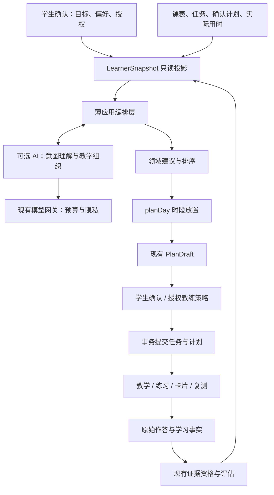

# Human–AI 自适应学习架构：从证据到可控计划

日期：2026-10-15。审查基线：`feat/opening-release` @ `544304e92c9ee77405e92d0b0c99586df388d377`。

**状态：架构建议。** 本次实现仅为 L1 的两项反馈规则修复及测试；L2–L8、真实模型/浏览器/部署验证并未因此完成。无迁移、开关或 CI 改动，不新建通用 Agent 框架。

## 1. 已核验现状

#43 已合并，包含自适应数据层与纯规则；#44/#45 已关闭且未合并，不代表对话规划已上线。`LearnerSnapshot` 当前主要包含课程、技能状态、到期卡片和建议历史。`assessment/status.ts` 已有能力维度与用户纠正，`opening/evidence-eligibility.ts` 已区分独立性、核对、版本和延迟资格。主讲编译开关开启时走真实 model gateway；关闭时仍有 stub。`provider.ts` 的回复与候选不是已接通的多工具规划循环。

关键缺口不是“更多 Agent”，而是让同一个学情投影被教学、对话和日程共同使用。以当前源码为准：`STATUS.md` 的 R1–R8 待合入表述已经落后于审查 HEAD。仓库对 Hermes 的描述未在本次现场核验。

## 2. 保持模块化单体，增加薄应用编排层



`packages/contracts` 管输入输出；`packages/domain` 管纯规则；现有 web server/use-case 层管认证、快照和应用编排；`packages/database` 管仓储与事务；`packages/ai` 与网关管生成；worker 管编译、材料和必要异步刷新。不要由编排层再做一套评分，不要让领域包依赖 HTTP/数据库，不因这次设计拆微服务或新增消息中间件。

## 3. 学生模型分四层

| 层次 | 内容 | 控制边界 |
|---|---|---|
| 学生声明 | 目标、考试范围、语言、时长、作息、档位 | 模型提取只形成待确认候选 |
| 观察事实 | 题目版本、首次作答、提示暴露、核对、实际用时 | 不被 LLM 的判断覆盖 |
| 能力估计 | 技能 × 能力维度、证据覆盖、方法与不确定性 | 可解释、可纠正；未知不伪装精确分数 |
| 临时情境 | 今日可用时间、自报疲劳、临时安排 | 有效期与可删除性，不变成长期标签 |

复用 `AbilitySlice`，按学科做量规映射而非跨学科总分。技能身份优先课程知识节点；显示名与身份分离，语义别名/跨版本等价需要审阅。R10 评审报告中的技能意图文本及 `firstAttempt=null` 应在接 BKT 前复核并解决；本次未修改该路径。多人共享工作区时需分离 workspace 权限与具体 learner 的证据，不混合多人作答。

## 4. 证据与教学

复用 `evaluateEvidenceEligibility`：`verifiedCorrect=yes` 为按规则核对正确，`no` 是有效的核对错误，`unknown` 是未能确认。**不能只用 yes 的样本，也不能把 unknown 当错误。** 独立性和版本适用性还要分别判断。参考答案自核保留来源，不冒充客观评分。

同题看答案后做对是纠错，不是新的独立掌握；任务 done 不等于学会；计划 25 分钟不等于实际学习 25 分钟。用已有课程/技能/活动/题目版本/attempt/草案 ID 串联证据来源与后续效果。

下一项活动先用规则：需要区分错因时短诊断；概念缺口时讲解；依赖提示时独立变式；独立完成后按范围提出迁移/延迟复测。学生仍可要求完整答案，系统标记辅助，不为采集证据强迫学生做题。教学呈现优先可追溯组件，不生成任意脚本界面。

## 5. 学什么与何时学分离

`rankForPlan` 排顺序，`planDay` 放时段；LLM 不负责时间算术。固定课表、睡眠/用餐、用户确认块、notBefore、时区和真实容量是约束。目标拆为阶段成果，不能只按 weeklyMinutes 判断学会或落后。

实际用时按活动类型积累，不直接复用计划时长当真值；预留可调整缓冲。冲突时说明未排入事项，不挤占休息或修改考试日期。一次跳过不是能力负证据；连续跳过可询问原因或保守减负，不诊断人格。

日内事件先更新事实，再判断是否值得重排。合并短时间内的变动，限制打扰；不要每答一题重排整天。学生已确认的时间块和进行中的任务应保持。

## 6. 接线与事务

优先扩展既有接口，以下为内部用例建议，不是已实现的新路由：

```text
readLearnerSnapshot(scope, {date, now})
buildDailyProposal(scope, request)
acceptDailyProposal(scope, request)
refreshAfterLearningEvent(scope, eventId)
```

L2 快照须包含同日 done/skipped 历史及早先仍 pending 的建议，本次去重修复才有效。按课程批量查询，使用学生确认时区；快照注明计划/设置/材料与隐私的必要版本及证据来源，不新增 hash 代替授权或事务。

接受时核验 scope、存储草案、选择的建议、版本、任务状态、来源权限与实际时段，在同一事务创建任务并接受计划。重复确认必须幂等；不信任客户端自带任务正文或模型声称的授权。

教练撤销是条件补偿：仅撤销本次创建且未开始的任务和仍可恢复的计划版本，不覆盖学生后续改动、不删除已有学习事实。学习事实保存不依赖模型成功；投影刷新可重试但不能返回假成功。复用现有 jobs 与幂等机制，不先造通用事件平台。

## 7. 人机控制与算法边界

沿用 manual/copilot/coach。副驾驶默认先建议后确认；教练仅在预授权预算内调整未确认内容，必须可撤销。修改已确认安排、目标、隐私、外部日历写入仍需对应授权。Today 展示下一项行动，可展开原因、依据、纠正和撤销。

后续 Agent 优先只读快照/材料/约束，写工具只创建待确认草案；禁止 `setMastery`。沿用预算、隐私、取消机制，设置循环步数和成本上限。模型不可用时继续笔记、已有活动、手工任务和规则排程。

先规则闭环，再影子比较 BKT 等可解释预测。FSRS 用于记忆复习，不代替全部能力或课程规划。按学生、时间、题目重复关系控制验证泄漏，关注校准和误报掌握，而非单看 AUC。论文不证明本产品效果；独立延迟表现、计划可执行性、纠正成本与模型费用都需实测。

## 8. 实施顺序与验收

| 次序 | 切片 | 最小验收 |
|---|---|---|
| P0 | 本次 L1 反馈修复 | 同日不复活、减负不增时长 |
| P1 / L2 | 真实快照 → 自适应草案 | 持久化证据改变草案，未接受不创建任务 |
| P2 / L3 | 事务接受选中建议 | 权限、陈旧版本、重复请求正确 |
| P3 / L4–L6 | Today 原因/目标/手工调整 | 学生可理解、纠正；浏览器待用户 |
| P4 / L3 教练 | 自动确认与条件撤销 | 不覆盖学生确认块或后续编辑 |
| 并行 | 技能身份与首次作答 | 标题变化不碎裂；提示不伪装独立 |
| P5 / L8 | 闭环指标 | 建议可追到证据、失败也统计 |
| P6 / L7 | 对话进入相同草案管道 | 不另建任务、计划或评分引擎 |

还须验证：有效负证据、重复作答、材料撤销、归档课程、跨时区/夏令时、并发确认、实际超时、预算耗尽、学习事实保存后的刷新失败。以上为后续验收要求，不代表本次已执行。

## 9. 本次修改与验证边界

`propose-tasks.ts` 两项修复：卡片连续跳过两天，使用适合短时间盒的下限（5→3、9→5，普通 25→13 保持）；同日 done/skipped 或仍 pending 的同身份建议不再出现，次日不永久屏蔽。没有改变卡片 SRS 状态、技能状态、草案事务或开关。

新增 `propose-tasks-feedback.test.ts`：32 项，覆盖 5–80 张卡片的单调减负、四类建议的同日状态、跨日、预算、手工模式、去重和确定性。通过隔离 TypeScript 转译 + Node test 执行相同测试断言；原代码 17 通过/15 失败，修复后 32/32。`addLocalDays` 用基线函数摘录；不是完整 Vitest/包类型检查。

完整依赖、DB、真实供应商和浏览器未验证。正常 checkout 仍需：

```sh
npx vitest run --project unit packages/domain/src/opening/adaptive
npm run typecheck -w @aistudy/domain
```

不提交本地测试日志或构建产物。不降低 CI。回滚只需撤销本次源码和测试，无数据迁移。

### 依据

源码：上述路径，以及 `docs/plans/2026-10-15-adaptive-learning-loop-v2.md`、`docs/plans/2026-10-15-review-and-next-steps.md`、`apps/worker/src/runtime/compile-teaching-unit-wiring.ts`、`packages/ai/src/opening/provider.ts`。

研究：Deslauriers et al. 2019，DOI 10.1073/pnas.1821936116（学习感与实际表现）；Karpicke & Roediger 2008，DOI 10.1126/science.1152408（检索与延迟保持）；Amershi et al. 2019，Microsoft Research *Guidelines for Human-AI Interaction*；Corbett & Anderson 1994，DOI 10.1007/BF01099821（知识追踪）；FSRS 官方项目（记忆调度）；Choffin et al. 2019，arXiv:1905.06873（技能练习与遗忘）。这些是设计依据，不是产品收益保证。
