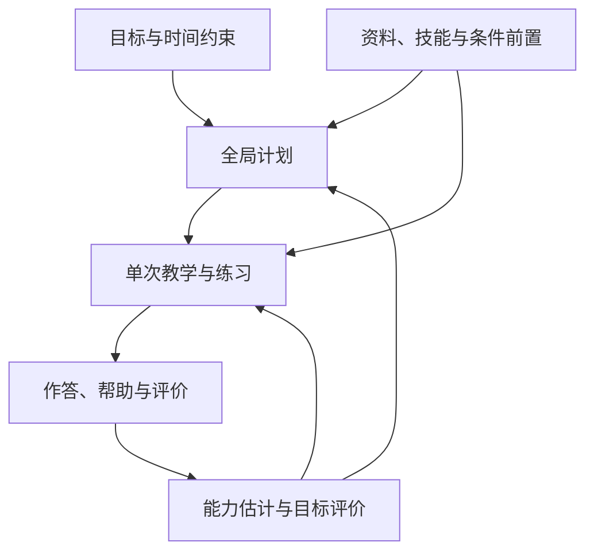

# 目标驱动学习框架与渐进改进计划

日期：2026-10-17

核对基线：`feat/opening-release` / `851e6ff`

状态：用户已授权目标方向与项目改进；首批已实现并完成独立审查修正，后续分阶段推进。本文不是全部功能完成声明，实际检查与交付状态以当前 PR/提交为准。

研究依据：[目标驱动学习研究](../brainstorm/2026-10-17-goal-driven-learning.md)。

## 1. 已确定的产品规则

1. 长期与短期目标并存。时间不足时服务当前优先目标，可减少理论扩展、集中题型和得分步骤；如实保留未验证和暂缓内容。
2. 拍照 AI 批改、手动判分、自我评价都支持。用户可以直接改评；系统更新有效判断，不要求走额外审核流程。
3. 偏好决定表达和节奏，实际目的决定训练要求；不能把“喜欢短讲解”当作“只需浅层理解”。
4. AI 可以主动补足达成目标所必需的前置知识。补习有范围、时间预算和原任务，不能无限遍历祖先节点。
5. 一套学习记录服务多个目标。课程进度、技能估计、考试准备程度分别解释，不能把看完课件或提示后做对直接算作独立达标。

## 2. 总体边界

保留 Web + Worker 的模块化单体与 PostgreSQL 事实源。调整业务边界和数据关联，不拆新微服务，不再创建独立“冲刺学习状态”。

| 边界 | 负责 | 不承担 |
|---|---|---|
| 目标层 | 目标范围、日期、优先级、成功条件、阶段策略 | 原始作答与永久能力事实 |
| 内容与关系层 | 材料来源、题目/版本、知识技能、解法、评分点及前置 | 自动宣告学生掌握 |
| 学习记录层 | 作答、已交付帮助、时长、评价及更正 | 直接决定所有目标达标 |
| 评估层 | 根据合格记录估计能力；按目标解释缺口 | 将模型概率当考试保证 |
| 全局计划层 | 在共同时间预算内选任务、排序、暂缓 | 生成新的学习事实 |
| 单次教学层 | 解释、例题、提示、必要补习、练习与小结 | 静默更改目标或长期技能身份 |

## 3. 目标层：复用已有模型，明确当前接缝

仓库已经有正式 [course_goals / goal_time_windows](../../packages/database/src/schema/goals.ts)，支持课程下不同 kind 的目标及阶段修饰。Opening 当前运行链读取 [workspace_preferences](../../packages/database/src/schema/preferences.ts) 中 `adaptive_planning.courseGoals`：按课程一个主日期、周分钟及 milestones。二者不是同一份数据。

**目标方向是让正式目标成为持久化权威源，Opening 消费统一运行时上下文。** 不新建第三套目标表，也不让两套来源长期互相覆盖。正式 schema 目前还有 course/kind 唯一约束；同类多场考试及跨课程单目标需在后续明确范围后扩展，首批不宣称支持。

首批仅兼容扩展原 JSON：

- `learningMode: auto | understand | exam`：省略视为 `auto`。
- `priority: 0..5`：省略视为 `0`，高值优先。
- 继续保留主日期、周预算、milestones、revision 和用户确认语义。
- `resolveGoalLearningContext` 从主日期和未确认里程碑中选择最近未过期日期；`auto` 在 7 天内采用应试策略，否则理解策略；显式模式覆盖自动选择。

7 天是本轮产品规则，不是研究证明的临界值；日期也不必然是考试。自动策略必须解释原因并允许切换。已确认里程碑不再作为临近触发项；历史日期不被自动改写或假装重新开放。

未来上下文可包含多个正式目标的范围和权重；本轮运行时上下文只表示当前课程节奏与临近目标，不能替代完整多目标要求集合。

## 4. 内容、技能与条件前置图谱

最终需区分：考点描述考试范围，题型描述任务模式，技能描述可观察能力，解法描述完成路径，评分点描述得分条件。题目步骤把这些对象关联起来。

前置需求以解法为条件：同一解法必要技能形成 AND，替代解法之间形成 OR。例如一题可以换元或分部积分，不能强迫学生掌握两套前置才开始。材料里的章节顺序只是组织信息，不自动等于能力依赖。

先解决当前身份断层：

- [图谱构建](../../apps/worker/src/jobs/build-course-knowledge.ts) 重建节点时分配新 UUID，无法直接承接长期历史。
- [快照聚合](../../packages/domain/src/opening/adaptive/assemble-snapshot.ts) 的 `nextSkills` 只留下标题；现有证据多按技能标签和 `requirementKey` 分组。
- 教学 `requirementKey` 带 blockId/contentVersion，用于版本资格隔离，不能拿来当稳定技能主键。

后续新增稳定技能映射时保留图版本、原节点、原标签和具体要求；重建、改名、拆分/合并不静默搬运全部历史。不能凭同名自动认定技能相同，也不能把哈希标题当作已解决身份问题。

首批只用当前快照内 `supported` 节点与 `supported` 直接前置边；目标及前置标签必须唯一、证据要求不歧义，前置有近期有效错误或提示依赖才插入最多一个短环节。无证据不补、含糊不补，不传播掌握状态。本轮 30 天近期窗口、应试 5 分钟/理解 10 分钟预算均为可调整规则。

这是一次教学内部的内容编排。提示“完成关键一步或到达预算后回原目标”，不等于已经实现跨 activity 自动返回、计时强制退出或补课完成门禁。

## 5. 统一作答与评价

复用已有会话 → 题目版本 → attempt → observation/有效修订链，继续关联已交付帮助。课程练习、冲刺、复测和模拟最终写入同一记录链，不按功能复制学习事实。

| 信息 | 保存方式与用途 |
|---|---|
| 原始作答 | 输入文字或后续照片资源引用；保留提交与题目版本 |
| 识别结果 | 后续照片转写的可修正派生内容，不能覆盖原图 |
| 评分 | 关联评分标准、步骤及评价来源；用户可直接更正 |
| 主观感受 | 猜的、不确定、觉得会了；可影响下一步，但单独保留 |
| 帮助 | 服务器确认交付的提示/答案，切换任务仍保留 |
| 评价更正 | 沿现有 revision/effective head 更新，影响当前投影与未执行建议 |

手动判分不需要额外审批；区分“纠正识别”“按评分标准判分”“自我感觉”是记录语义，不增加学生操作负担。拍照步骤评分、OCR 纠正界面、部分分与错因映射属于后续切片，本轮不声称完成。

## 6. 目标相对评估

能力估计回答“现有证据说明什么”，目标评价回答“这些证据满足本次目标多少要求”。同一次提示后正确，可以支持教学进展，但不等于限时独立解题达标。

学生应分别看到：

- 学习覆盖：学过、练过、尚未覆盖。
- 能力证据：独立完成、依赖提示、待复测、证据不足。
- 目标准备：范围缺口、题型表现、速度与综合题验证情况。

BKT 保留为可替换估计器/现有测量插件，不把参数变化直接写成事实，也不因单题错误把全部相关技能判弱。生产接管前需稳定技能身份、分项证据、事前预测和独立后测，至少与简单近期表现基线比较。潜在掌握概率、下一题答对概率和考试分数预测分别表达。

教师题型倾向属于目标内容权重，个人掌握属于能力状态；两者可以共同影响排序，但不混成一个概率。少量练习资料只能支持题型统计，不能声称预测教师出题概率。

## 7. 全局规划与单次教学

### 全局规划

输入所有可用课程目标上下文、任务、可用时段、固定安排、复测/推迟时间和合格学习信号；输出同一份计划草案与理由。任务真实 deadline 和 `notBefore` 继续约束可执行时间。临近且高优先目标可以超过普通积压，课程轮换不应把这一决定再次打散。

目标优先级要同时作用于候选预算和排序：如果普通建议先占满预算，再排目标任务，排序改动就无法发挥作用。预算使用扣除已过时间、确认缓冲和固定占用后的真实空档，应试建议可缩短至能放入的连续时段，最低 10 分钟；不足时不虚构可执行任务。相同活动服务多个目标时只能花一次时间；完整多目标共享收益归属留待正式目标桥接。

保持既有手工/副驾驶/教练档位与计划接受、撤销、并发语义。用户允许主动前置补习，不自动等于授权改写已接受日程。超出可用时间时保留未安排项和原因，不虚构完成计划。

### 单次教学

输入当前任务、目标上下文、具体要求、学习证据、已交付帮助、相关材料及可用前置。输出本次教学 focus 与内容，必要时在同次教学内先补一项前置再回目标。

| 目的/状态 | 默认教学倾向 |
|---|---|
| 长期理解 | 解释理由、概念联系、例题与迁移；仍按实际卡点调整 |
| 临考应试 | 题型识别、关键步骤、常见失分、短例题与独立变式 |
| 必要前置存在明确薄弱证据 | 有限补习，达到关键一步或时间预算后回目标 |
| 已有帮助或答案暴露 | 继续教学，并保留帮助资格；后续用新题验证独立表现 |

目标上下文由服务端创建活动时确定并保存为本次活动快照；后来调整课程偏好影响新活动，不静默改写正在进行的教学。服务器在编译前重读有效学习证据与当前材料图谱，清除失效的前置建议，不能只信任客户端提交的 focus。AI prompt 接收这份目标上下文与仍有效的有界补习说明；缺失输入时保持原教学路径，不生成虚构前置弱项。带前置建议的生成内容只允许一个原目标作答题及紧随其后的答案块，前置仅用讲解/步骤/例题，避免把前置作答误记到原目标；结构校验不能替代题干语义验证。

## 8. AI 与程序边界

| 工作 | AI | 确定性程序/学生 |
|---|---|---|
| 材料与图谱 | 提取、提出关系与解法候选 | 保留来源和状态，校验授权/版本；学生可纠正 |
| 教学 | 解释、例题、提示、内容内补习 | 选择目标与预算、检查输入、记录实际帮助 |
| 批改（后续） | 转写、提出步骤评分与错因 | 校验可计算部分、保存依据；用户最终改评 |
| 计划 | 解释取舍、建议活动 | 持有时间和截止约束、排序和计划写入 |
| 评估 | 补充解释 | 从有效记录计算；模型不能自行写“已掌握”事实 |

不为低概率争议增加审核状态机。现有角色、材料准入、调用预算和版本检查继续生效；模型输出是生成内容或候选判断，不能夹带目标/权限修改命令。

## 9. 学生信息层与功能取舍

学生默认看到下一项行动、时间、原因和完成要求。课程配置允许选择自动/理解/应试及优先级；教学中显示“为什么这样学”，有前置补习时说明补什么、多久和回到什么。

| 功能 | 调整方向 |
|---|---|
| 今日/计划 | 统一入口与时间预算；展示目标理由和未安排缺口 |
| 课程学习与冲刺 | 共用内容、作答和证据；冲刺成为策略与活动组合 |
| 错题、复测、卡片 | 保留各自活动语义，合入统一任务协调；不各自复制目标与掌握状态 |
| 笔记与自由探索 | 保留个人资产与自由学习；冲刺期间降低入口优先级，不删除内容 |
| 图谱 | 默认展示当前位置、当前阻塞前置和目标题型；完整图用于展开探索 |
| BKT 参数、内部权重 | 放诊断/研究面板，不作为日常学生决策界面 |
| 无限出题、精确提分预测 | 暂缓；先完成可靠题目关联与真实独立验证 |

退役对象是重复入口、重复状态维护和不适用的固定排序，不是批量删除学生数据。旧功能只有替代流程已贯通、可回退时才退出主路径。本轮不实施全站导航重排或历史数据清理。

## 10. 数据存储与迁移顺序

| 数据 | 现有落点 | 首批/后续处理 |
|---|---|---|
| 正式多目标与阶段 | `course_goals`、`goal_time_windows` | 保留；后续作为目标权威源接入 Opening |
| Opening 课程节奏 | `workspace_preferences.adaptive_planning.courseGoals` | 本轮兼容新增 mode/priority；随现有偏好备份 |
| 课程图谱 | `opening_course_knowledge.snapshot` 与 `source_versions` | 本轮只读 supported 关系；后续稳定技能映射 |
| 教学活动与内容 | `opening_teaching_activities`、`opening_teaching_content` | 目标上下文进入 focus/编译；不建立平行会话系统 |
| 作答/题目版本 | `opening_learning_attempts`、`opening_learning_item_versions` | 后续桥接照片、冲刺、分项证据 |
| 帮助/评价 | `opening_help_exposures`、`opening_learning_observations` | 复用修订链和有效 head；原始依据保留 |
| 计划 | `opening_tasks`、`opening_plan_drafts` 等既有表 | 目标理由进入原排序/预算链；保留版本与接受语义 |
| BKT 测量 | `opening_measurement_*` | 保持试验边界，不直接接管正式评价 |

迁移按依赖推进：

1. **兼容策略切片（本轮）：**原 JSON 可选字段、规则上下文、排序/预算、教学与 UI。无新增数据库迁移；回退代码保留原 JSON 数据，新字段省略时仍可读取。严格 schema 的旧服务写回可能剥离或拒绝新字段，部署/回退需保留兼容读写，不能把“JSON 无 DDL”当作无兼容风险。
2. **正式目标桥接：**盘点正式目标读写与约束，定义一个权威写入口和 Opening 适配器；将原课程节奏保留为规划偏好。对能确定归属的数据建立映射，歧义保留原样供一次性选择；不猜测日期就是考试，不双向长期同步。切换前验证计数、读取一致性、备份恢复；回滚读适配器，不删原目标。
3. **稳定技能与要求映射：**为图谱重建、改名、拆分合并定义持续身份；把具体题目/步骤/要求映射到技能。历史只能可靠映射的才回填，保留未知与原字段；新关联采用可空加法迁移，回滚时停用新读路径而保留历史。
4. **统一活动桥接：**将冲刺 PR #64 的训练/提交与课程、技能和 attempt 链连接；接入照片转写、步骤评分、手动改评与复测。既有冲刺记录先可追溯迁移，再停止重复写入，不伪造历史 firstAttempt 或无提示状态。
5. **条件路径与目标评价：**在身份和步骤关联稳定后实现 AND/OR 前置、目标范围/评分点覆盖、完整限时模拟；再评估 BKT 生产消费是否有价值。

后续新增表/列沿现有 migration、备份/恢复和删除机制执行，使用外键、事务和版本处理实际一致性问题；不引入通用事件总线或额外影子目标账本。

## 11. 本轮可交付切片与明确未完成项

| 本轮范围 | 验收结果应证明 |
|---|---|
| 课程 mode/priority 与旧数据兼容 | 原配置可读写，新配置刷新后保持；里程碑历史不丢 |
| 统一 `GoalLearningContext` | 解析日期、显式模式、临近规则一致；规划和教学使用同一语义 |
| 目标排序与候选预算 | 临考目标可超过普通积压；真实截止、notBefore、固定安排仍有效 |
| focus → DB 重查 → AI prompt | 目标信息真正进入执行链，服务端不接受过期或伪造 focus |
| supported 直接前置短补习 | 只选最多一个有近期薄弱证据且无身份歧义的前置，说明返回目标 |
| 学生配置和教学说明 | 能选模式/优先级，能看到目标理由与前置说明 |

本轮不宣称完成：正式多目标端到端接入、跨课程目标、稳定技能身份、AND/OR 解法图、跨 activity 自动返回或强制补课完成、照片步骤评分、冲刺 PR #64 课程桥接、BKT 生产接管、教师命题概率或考试分数预测。

## 12. 验证与交付标准

工程检查以最近的单元/契约、数据库/handler及受影响包类型检查为准；文档只检查 diff。测试证明工程行为，不证明学习效果。

| 场景 | 预期 |
|---|---|
| 长期目标与三天后的目标竞争普通积压 | 近期高优先目标获得候选与顺序，不能只改理由文案 |
| 真 deadline、notBefore 与目标优先级冲突 | 保留真实截止及时间准入，目标不修改原字段 |
| mode 显式 understand / exam 与 auto | 显式值被尊重；auto 依据本地日历及未确认日期计算 |
| 目标、材料或学习证据在编译前变化 | 当前活动保留创建时目标策略；材料/证据重查后清除失效前置，新活动采用新偏好 |
| 图边 suggested、标签重复、多要求或无有效观察 | 不自动插入前置补习，不假造不会或掌握 |
| 前置有有效近期错误/提示依赖 | 最多一个短环节；明确原目标和返回条件 |
| 新旧偏好、里程碑确认和备份恢复 | 不丢原信息，不将 milestone 确认等同独立掌握 |

用户浏览器验收：进入课程目标配置，切换 mode/priority 并保存；刷新检查保持；在有材料和学习记录的课程查看今日草案及理由，开始任务检查教学说明；存在可匹配 supported 前置弱项时检查短补习说明。前提是对应服务与已有自适应开关已启用。状态标记“待用户浏览器验收”，不由 Agent 自动运行浏览器或截图。

真实学习验证以相同时间预算下的未见题独立表现、限时得分与长期延迟保持为主；同时观察补习负担和用户改序次数。先检查资料/身份/记录是否可信，再比较规则。任务完成率、聊天次数或 BKT 拟合更好都不能单独证明学习收益。

首个完整产品验收场景为：Math I 目标 → 代表题诊断 → 具体失分步骤 → 必要前置补习 → 原题型训练 → 限时验证 → 剩余安排调整。本轮打通其中目标对规划与教学的影响，其余按上述迁移依赖继续推进。
