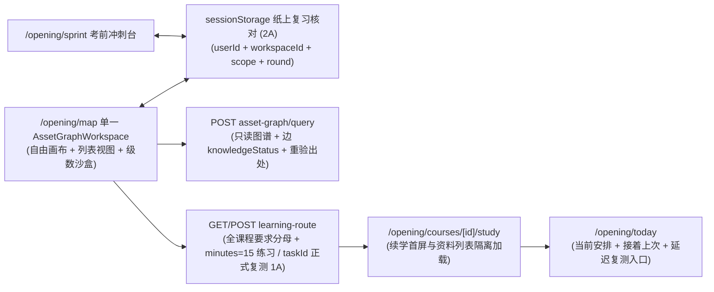

# 知识地图收束与学习内核协同实施计划

日期：2026-11-19

核对基线：`feat/opening-release` / `b1b98a9c`（已含 `#449`–`#456` 及跨日改排 `#454` `eb966c84`；`integration/opening` 已同步 `#448`）

状态：用户已批准整体收束决策，并明确选定 **1A（15 分钟学习意图）** 与 **2A（浏览器会话级跨页可撤销纸上复习）**。本文定义进入编码切片与用户浏览器验收前的统一产品规则、模块接口边界与分步推进顺序；实际交付状态以具体 PR 与精确提交 CI 为准。

研究依据：[知识地图收束与学习内核协同研究](../brainstorm/2026-11-19-map-and-kernel-convergence.md)、[个人知识资产图的数据与接口对接](../brainstorm/2026-11-18-knowledge-assets-api.md)、[长效学习 Agent 的候选架构](../brainstorm/2026-11-18-long-running-learning-agent.md)。

## 1. 已批准的核心决策

1. **考前「15 分钟」入口采用学习意图语义并严格保护正式复测任务绑定（决策 1A）**：
   - 在 `/opening/map` 选定课程上下文后，直接复用课程学习路线快照（`GET /api/opening/courses/[id]/learning-route` 返回的 `CourseRouteSnapshot`）作为**全课程要求分母**，废除仅按图谱分页前 40 个根节点做客户端局部推荐的做法。
   - 当 `scopeState !== "confirmed"` 时，明确引导先去课程确认学习范围，不猜测候选要求；当 `scopeState === "confirmed"` 时，基于服务端返回的 `CourseRequirementProgress` 按确定性优先级选出下一项可行动要求与一句可核对事实原因，支持在画布或列表视图中一键定位该节点。
   - 对普通练习候选要求，在触发 `startCourseRequirement` 进入课程学习工作台时**默认预选 `minutes = 15`**（学生仍可在进入前调整时长）；对已进入复测窗口的延迟复测要求（含当前 `status === "verified"` 但存在到期维护复测的项），**严禁无 `taskId / expectedTaskVersion` 直接调用普通 `executeStartRequirement`**（否则服务端 [opening-course-route-actions.ts](../../packages/database/src/repositories/opening-course-route-actions.ts) 第 201–214 行不会绑定正式复测活动，反而会创建间隔期普通练习），必须携带绑定的待处理 `taskId + expectedTaskVersion` 启动正式复测，或在未拿到任务上下文时明确引导至 `/opening/today` 复测入口。
   - 首版不新增服务端“15 分钟完赛承诺”接口，也不与 `#454` 当日例外容量账本耦合双写。
2. **「本轮纸上已复习」保留为浏览器会话级跨页可撤销核对（决策 2A）**：
   - 使用 `window.sessionStorage`（经 Zod 严格校验）在 `/opening/map` 与 `/opening/sprint` 之间共享当前考前复习轮次的纸面接触勾选，支持随时勾选、撤销与“开启新一轮纸上核对”。
   - 严格与服务端 `LearnerState`、`RequirementStatus`、`delayedCheck` 及作答历史隔离（零数据库迁移、零写请求）；界面明确标注“仅用于本次浏览器会话的纸面核对，不计入独立掌握”。
3. **单一 `AssetGraphWorkspace` 收束自由画布与列表视图**：
   - 保留 `#450` 已合入主线的单一 `AssetGraphWorkspace` 状态机（统一查询竞态保护、`CURSOR_STALE` 恢复、隐私变更重刷、焦点管理与 `AssetGraphListView`），将自由画布交互（子树拖拽、二维根节点初始排布、离屏节点定位、节点级 `localStorage` 纯坐标记忆与级数内置沙盒示例）作为画布渲染层并入其中，移除平行重复的 `FreeMapEntry` 与 `free-map-review.tsx` 局部状态机。
4. **零迁移原子切流透出课程知识边核验状态与重验出处**：
   - 在模块化单体内同单升级契约、前端读取与服务端投影，将课程知识快照边已有的 `status`（`suggested | supported | needs_check`）透出到 `AssetGraphEdge`，不再将 `needs_check` 与 `supported` 混同为同一种无区分记录边；对 `evidenceChunkIds` 在服务端按当前课程成员、可读版本与隐私排除条件重验后返回真实资料版本与正整数页码（缺失页码时省略 `page`，严禁用 `chunk_index` 替代），并纳入 `scopeFingerprint` 游标失效计算。
5. **追问/反例默认临时化，微探针与真实复测严格隔离**：
   - 知识边上的“一句话追问 / 反例核对”默认只读临时展示，不在画布预取会触发帮助放行回执的笔记正文；仅当学生显式保存时，走既有 `study-notes` 保存到课程或课程要求。
   - 两步诊断微探针首版仅在内置级数沙盒示例中运行；真实课程待复测要求在学生未明确做出“先测还是先学”选择前，不提供会写入中间作答或放行帮助的内联探针，确保不破坏延迟复测的 `independent` 资格。
   - 无课程自由写作继续保持零自动排程。
6. **在开启下一波复杂特性前先跑通闭环与用户浏览器验收**：
   - 顺手补齐课程续学首屏与资料列表的故障隔离、活动结束小结的单一下一步动作接线，以及多工具协作减负规范，在已合入主线的 `#454` 与上述零迁移切片收口后暂停新表扩张，交用户完成浏览器走查与单高数专题校准。

## 2. 协同架构与模块边界

### 2.1 地图考前挑题与 15 分钟学习意图（1A 规格）

- **数据输入**：仅在 `context.kind === "course"`（或目标所属单门课程已明确）时，调用既有 `CourseRouteClient` 读取 `CourseRouteSnapshot`（[course-route.ts](../../packages/contracts/src/opening/course-route.ts)），并按需核对当前待处理复测任务上下文（`taskId`、`expectedTaskVersion`）。
- **分母与前置判断**：
  - 若 `snapshot.scopeState !== "confirmed"`：显示“当前课程尚有待确认的学习要求范围，请先确认范围后再按全课优先级挑题”，提供跳转课程范围确认入口。
  - 若 `snapshot.scopeState === "confirmed"`：显示全课程有效要求分母（如 `全课共 N 项要求，已验证 V 项`）。先排除 `status === "blocked"` 的项（若存在 `blocked` 项，单独提示阻塞数量而不混入可立即作答推荐）；**注意不得在检查 `delayedCheck` 之前提前过滤掉 `status === "verified"` 的要求**——仅当某项 `status === "verified"` 且不存在到期 `delayedCheck`（`delayedCheck?.status === "pending"` 且 `notBeforeAt <= asOf`）时才跳过；对于 `delayedCheck?.status === "pending"` 但 `notBeforeAt > asOf`（仍在等待窗口内）的要求，单独提示复测开放时间而不触发会污染间隔期独立资格的普通练习。
- **确定性排序规则**（仅依据服务端已返回字段，不推断未返回答题结果；注意服务端快照中 `status === "needs_correction"` 与到期 `delayedCheck` 独立计算、可同时成立，**必须先归类待处理正式复测，再归类普通练习**）：
  1. `delayedCheck?.status === "pending"` 且 `notBeforeAt <= asOf`（已到复测窗口，无论当前 `status` 为 `"verified"`、`"needs_correction"` 或其他值，一律先走正式独立复测分支，严禁落入普通纠错练习而污染复测窗口）；
  2. `status === "needs_correction"`（且无等待中或已到期 `delayedCheck`，有待纠错作答，优先重做出错步骤）；
  3. `status === "assisted"` 或 `status === "needs_verification"`（且无等待中或已到期 `delayedCheck`，上次受助完成或证据尚不足，需补一次独立检验）；
  4. `status === "unobserved"`（尚无作答证据，可先做首道诊断练习）。
  - 同级内部按：① 本轮尚未标记“纸上已复习”（2A）优先于已标记项（若同级全部已纸上勾选，仍保留该项并标注“本轮纸上已过，仍待线上独立验证”）；② `requirement.mandatory === true` 优先；③ `requirement.position` 升序稳定打破平局。
- **动作衔接（严格区分正式复测与普通 15 分钟练习）**：
  - 「在图中定位这项要求」：若当前图谱已加载对应 `requirement/<id>` 节点则直接选中并平移画布/滚动列表至可见区域；若尚未在当前分页窗口内，则以该 `requirement/<id>` 作为 `focus` 执行 `neighbors` / `detail` 查询并定位。
  - **当命中的是第 1 类「到期独立复测」时**：由于服务端 [opening-course-route-actions.ts](../../packages/database/src/repositories/opening-course-route-actions.ts) 第 201–214 行仅通过 `taskId` 与 `expectedTaskVersion` 绑定 `opening_retest_activities`，前端必须携带完整乐观并发字段与复测任务标识（`{ goalId, expectedGoalRevision, requirementId, expectedRequirementRevision, taskId, expectedTaskVersion, minutes: 15, clientKey }`）调用 `routeClient.start`，或当客户端未持有对应任务版本时引导跳转 `/opening/today` 的正式复测入口；**严禁在缺失 `taskId / expectedTaskVersion` 时回退调用普通 `executeStartRequirement`**。
  - **当命中的是第 2/3/4 类「普通要求练习/检验」时**（且该要求无等待中或已到期 `delayedCheck`）：将 `AssetGraphWorkspace` 的 `selectedMinutes` 预置为 `15`，复用既有 `executeStartRequirement`（调用 `routeClient.start(courseId, { goalId, expectedGoalRevision, requirementId, expectedRequirementRevision, minutes: 15, clientKey })`，对齐 [course-route.ts](../../packages/contracts/src/opening/course-route.ts) 第 49–53 行）进入 `/opening/courses/[id]/study`。

### 2.2 会话级跨页「本轮纸上已复习」（2A 规格）

- **共享模块位置**：新建轻量前端纯客户端模块 `apps/web/src/features/opening/shared/paper-review-session.ts`（供 `asset-graph` 与 `exam-sprint` 共同调用，不进入服务端或跨包持久化契约）。
- **存储介质与键隔离**：
  - 使用 `window.sessionStorage`，键格式为：`aistudy:paper-review:v1:${userId}:${workspaceId}:${scopeKind}:${scopeId}`（其中 `scopeKind` 为 `"course" | "goal"`）。
  - 值采用 Zod 严格校验：
    - `version: 1`
    - `roundNumber: number`（正整数，默认 `1`，“开启新一轮纸上核对”时递增并清空 `items`）
    - `updatedAt: string`（ISO 时间）
    - `items: Record<requirementId, { requirementRevision: number; markedAt: string }>`
- **安全与失效规则**：
  - 读取时核对当前课程要求列表：若某 `requirementId` 已不存在或当前 `requirement.revision !== item.requirementRevision`，该条目自动视为失效并在下次写入时清理，绝不将旧版本勾选套用到修订后的要求上。
  - 监听既有隐私变更通知（`subscribeOpeningPrivacyChange`）以及身份/工作区切换；当 `userId` 或 `workspaceId` 尚未就绪或 `sessionStorage` 被浏览器禁用时，优雅降级为不持久化或禁用勾选按钮，不阻塞地图浏览或冲刺答题。
  - 同页与同标签页内路由切换（`/opening/map` ↔ `/opening/sprint`）读取同一 `sessionStorage` 键，保持勾选计数、单条撤销与轮次重置完全一致。

### 2.3 知识边核验状态与重验出处（零迁移契约与 `.strict()` 显式协商切流规格）

- **契约增量与已打开旧标签页 `.strict()` 兼容策略**：当前 [asset-graph.ts](../../packages/contracts/src/opening/asset-graph.ts) 第 258–269 行的 `assetGraphEdgeSchema` 及 [asset-graph-client.ts](../../apps/web/src/features/opening/asset-graph/asset-graph-client.ts) 第 188–205 行均使用 `.strict()` 解析，即使同版本发布，浏览器中尚未刷新的已打开地图标签页在发起下一次查询时若收到未知边字段仍会拒绝整页响应。因此必须采用**请求显式协商（Client Opt-In）+ 默认保留 v1 边响应形状**：
  - 查询请求新增可选协商标记（如 `includeKnowledgeEdgeDetails: z.boolean().optional()`，旧客户端未传或为 `false` 时服务端严禁下发新增边字段，100% 兼容在途已打开的旧 `.strict()` 标签页；新客户端显式传 `true` 时服务端才投影新增边字段，并将该协商位纳入 `scopeFingerprint` 防止跨模式混用游标）；
  - `knowledgeStatus: z.enum(["suggested", "supported", "needs_check"]).optional()`：仅在客户端显式协商开启时允许出现在 `contains | prerequisite | appliesTo` 课程知识边上；当 `knowledgeStatus === "suggested"` 时 `basis` 仍为 `"suggested"`，当 `knowledgeStatus` 为 `"supported"` 或 `"needs_check"` 时 `basis` 保持 `"recorded"`，由 `superRefine` 保证一致性；
  - 复用 `assetGraphEdgeSchema` 已有的 `sourceVersion`、`page`（正整数）以及新增可选 `sourceNodeId: assetGraphNodeIdSchema.optional()`（`superRefine` 校验须以 `source/` 开头），仅在客户端协商开启且服务端完成重验后填入代表性可读证据锚点。
- **只读仓储重验与游标指纹**（[opening-asset-graph.ts](../../packages/database/src/repositories/opening-asset-graph.ts)）：
  - 去重优先级固定为：`supported > needs_check > suggested`。
  - 解析 `edge.evidenceChunkIds` 时，必须核对对应 chunk 所属 `source_id` 当前仍绑定于该课程、处于当前工作区可读版本且未被隐私设置排除；若 `chunk.page` 为 `null` 或非正整数，只允许携带经重验的 `sourceNodeId` / `sourceVersion`，**严禁用 `chunk_index` 伪充页码**；若全部引用资料已撤权或不可读，则不返回任何出处字段，且若原状态为 `supported` 则在投影层按只读降级提示为 `needs_check`（不静默改写底层快照表）。
  - 将可见课程知识快照版本、边状态摘要、可读资料纪元与**实际生效**的边详情投影位一并纳入 `scopeFingerprint`，确保资料撤权、重新构图、隐私变更或投影开关切换后旧分页游标确定性返回 `CURSOR_STALE`。
  - **在途新标签页无 `400` 服务端回退规则**：由于 [query/route.ts](../../apps/web/src/app/api/opening/asset-graph/query/route.ts) 同样使用 `.strict()` 解析请求体，且已打开标签页在回退后仍可能继续发送 `includeKnowledgeEdgeDetails: true`（仅回滚前端无法覆盖存量已打开标签页），回退时禁止直接移除请求契约中的可选 `includeKnowledgeEdgeDetails` 字段，也不可仅靠前端停发替代服务端关闸；**必须在服务端关闭边详情投影开关**（前端停发仅作为新开标签页的可选配套）并继续接受 `includeKnowledgeEdgeDetails?: boolean` 作为无副作用 no-op，确保回退后继续传 `true` 的请求仍返回 HTTP `200` 旧版边形状，且开启期签发的旧游标因实际生效投影位变化返回 `CURSOR_STALE`。

### 2.4 续学首屏故障隔离与活动小结衔接

- **续学工作台拆分加载**（[course-study-workspace.tsx](../../apps/web/src/features/opening/courses/course-study-workspace.tsx) / [course-detail.tsx](../../apps/web/src/features/opening/courses/course-detail.tsx)）：
  - 将课程元信息与当前教学/练习活动恢复设为主阻塞读取，课程完整资料列表改为独立异步读取与局部重试状态。
  - 当课程与原活动有效而资料列表接口偶发报错时，学生仍可继续当前练习或复测；仅在新建强依赖实时资料列表的动作时做原有前置检查。
- **活动结束小结单一推荐动作**（[activity-summary-card.tsx](../../apps/web/src/features/opening/teaching/activity-summary-card.tsx) + [next-learning-step.ts](../../packages/domain/src/opening/adaptive/next-learning-step.ts)）：
  - 根据本次活动是“受助完成”还是“独立完成”直接给出单一主行动：受助完成者提示“趁热试一道无提示同源题检验独立度”，已取得独立证据者提示“确认后续延迟复测安排”，避免学生自己猜测是否真正掌握。

## 3. 未合入原型候选模块与远端主线的无损收束清单

针对尚未合入主线的协作文档与自由画布原型候选模块，推进实现时严禁执行破坏性清理，统一在独立 `worktree` 中基于最新 `feat/opening-release`（`b1b98a9c`）干净整合：

| 未合入候选模块 | 处置策略 | 目标归宿 |
|---|---|---|
| `.agents/skills/aistudy-autopilot/SKILL.md`、`docs/operations/agent-workflow.md` | 核对最新门禁规则后独立整理为文档类（`L`）切片提交 | `integration/opening` → 批次提升至 `feat/opening-release` |
| `free-map-canvas-geometry.ts`、`free-map-canvas-gestures.ts`、`free-map-canvas-layout.ts`、`free-map-canvas-node.tsx`、`free-map-canvas-storage.ts`、`free-map-canvas.tsx` 及其单测 | **保留并接入单一工作台**；`free-map-canvas-storage.ts` 的 `persistKey` 强制拼入 `userId:workspaceId:contextKey`，仅存有限数值坐标 | 并入 `apps/web/src/features/opening/asset-graph/`，由 `AssetGraphWorkspace` 驱动 |
| `series-map-example-model.ts`、`series-map-example.tsx` 及其单测 | **保留为内置沙盒示例模式**，承载两步诊断微探针与级数判别法关系演示，明确标识“示例沙盒 · 不计入个人课程记录” | 并入 `AssetGraphWorkspace` 示例入口 |
| `free-map-entry.tsx`、`free-map-navigation.tsx`、`free-map-review.tsx` 及其单测 | **不保留独立双入口与 40 项分页挑题实现**；其考前挑题与纸上勾选需求改由 `learning-route`（1A，含到期复测优先判定与任务强绑定）+ `paper-review-session.ts`（2A）在统一工作台与冲刺台中实现 | 逻辑升级吸收，消除重复状态机 |
| `opening/map/page.tsx`、`asset-graph-model.ts`、`asset-graph-workspace.tsx` | 以远端 `#450` 最新版本为基底，融合自由画布视图、列表视图与 `1A/2A` 面板 | `apps/web/src/app/(opening)/opening/map/page.tsx` 及 `asset-graph` 模块 |

## 4. 分切片推进顺序与验收门禁

1. **切片 0（基线收口与协作减负）**：
   - 已完成：PR `#454`（`eb966c84`，当日例外与跨日复测改排）、`#455`（CI 看门狗加固）与 `#456`（Wave 1–2 状态同步）已合入 `feat/opening-release`（相关 UI 保留在阶段末统一交用户浏览器验收）；
   - 待收口：在独立 `worktree` 按 `L` 类路径提交多工具协作文档细则更新（`agent-workflow.md` 与 `aistudy-autopilot/SKILL.md`：默认单文件单测 + 所属包 `typecheck`，禁委派并行跑全仓 `build`，双审汇聚后单轮返工）。
2. **切片 1（知识地图单一工作台收束 + 1A + 2A，H 级主线 PR）**：
   - 基于 `feat/opening-release` 最新头整合 `FreeMapCanvas`、`AssetGraphListView`、级数沙盒示例、`learning-route` 全课挑题 + 普通练习 `15` 分钟预填与到期复测优先判定及 `taskId + expectedTaskVersion` 强绑定（1A），以及跨 `/opening/map` 与 `/opening/sprint` 共享的会话级“本轮纸上已复习”（2A）；
   - 验证：相关 `unit` 单测（含视图切换焦点恢复、未确认范围提示、`verified` 项到期复测不被漏筛、**`needs_correction` 与到期 `delayedCheck` 同时成立时优先归为正式复测夹具**、到期复测禁止无 `taskId` 降级启动、`minutes=15` 透传、`sessionStorage` 版本失效与零服务端写入断言）+ `@aistudy/web` 类型检查 + `eslint` + `check-new-fixed-colors` + `check-learner-copy`。
3. **切片 2（课程知识边 `knowledgeStatus` 与重验出处，H 级主线 PR，可与切片 1 同单原子合流）**：
   - 扩展 `asset-graph` `.strict()` 契约、客户端显式协商参数（`includeKnowledgeEdgeDetails`）、服务端投影关闸开关与 `opening-asset-graph.ts` 只读投影，默认向未协商旧标签页保持原严格边形状，协商且服务端开关开启时透出 `suggested / supported / needs_check` 边样式区分、重验页码/资料版本展示与实际生效投影位 `scopeFingerprint` 游标失效；
   - 验证：`packages/contracts`、`packages/database`、`apps/web` 类型检查 + 契约/仓储/handler 测试（**含未传协商参数的旧 `.strict()` 客户端请求新服务端不报未知字段，以及服务端回退关闭投影后仍发送 `includeKnowledgeEdgeDetails: true` 的请求返回 HTTP `200` 原边形状且开启期旧游标返回 `CURSOR_STALE` 的回归用例**）+ `check-api-contracts --strict` + `check-server-boundary`。
4. **切片 3（续学首屏解耦与活动小结单一下一步接线，H 级主线 PR）**：
   - 拆分 `course-study-workspace` 的课程/活动核心加载与资料列表二级加载，接通 `activity-summary-card` 单一下一步动作；
   - 验证：课程工作台故障注入单测（资料列表失败不阻断续学答题）+ 小结动作分支单测 + `@aistudy/web` 类型检查。
5. **阶段性暂停门（用户浏览器验收与单专题校准）**：
   - 上述切片合入后，由唯一集成者同步一次 `docs/STATUS.md`，**暂停新增数据库表或新业务面**；
   - 交用户按“地图全课挑题（15 分钟预设）/ 纸上勾选跨页核对 → 独立作答 → 回图看新证据与边出处 → Today 或绑定任务延迟复测”路径完成真实浏览器验收，并用高数级数专题跑通 `loop-metrics` 的首次独立表现与隔天复测配对记录，再启动商业化公开案例页与试用转化入口。
